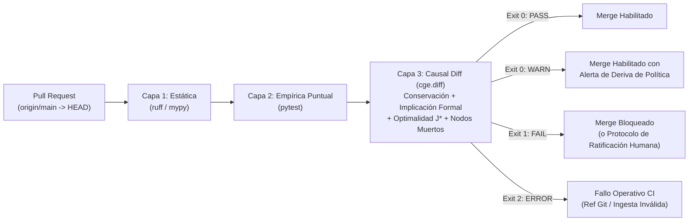
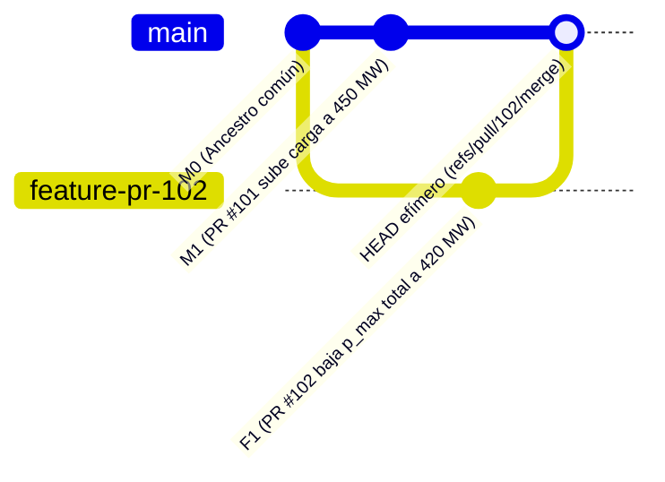

# 04 — Especificación de Integración de Causal Diff en CI/CD y Gobernanza de Pull Requests

**Estado:** Especificación Arquitectónica y Operativa (Alineada con el MVP `cge/diff/` v0 y Hoja de Ruta v1)  
**Módulos de referencia:** [`cge/diff/__main__.py`](../cge/diff/__main__.py), [`cge/diff/engine.py`](../cge/diff/engine.py), [`cge/diff/git_integration.py`](../cge/diff/git_integration.py)  
**Documentos relacionados:** [`01_ALCANCE_Y_ONTOLOGIA_DOMINIO.md`](./01_ALCANCE_Y_ONTOLOGIA_DOMINIO.md), [`02_FRONTERA_IMPERATIVA_Y_CONTRATOS.md`](./02_FRONTERA_IMPERATIVA_Y_CONTRATOS.md), [`03_TIEMPO_ESTADO_Y_CICLOS.md`](./03_TIEMPO_ESTADO_Y_CICLOS.md), [`05_CATALOGO_ESCENARIOS_ORACULO_MCP.md`](./05_CATALOGO_ESCENARIOS_ORACULO_MCP.md)

---

## 1. Tesis Arquitectónica: Por Qué el CI Tradicional es Ciego a las Regresiones Causales

En sistemas cuantitativos de negocio e ingeniería (cadenas de suministro, motores actuariales/fiscales, despacho de energía, epidemiología, pricing algorítmico), las tuberías clásicas de Integración Continua verifican únicamente **dos capas superficiales**:

1. **Validez léxica y de tipos (`ruff`, `mypy`):** Garantiza que el código compila y respeta firmas estáticas, pero no distingue `y_star = c_star + i_star` de `y_star = c_star - i_star`.
2. **Muestreo puntual sesgado (`pytest`):** Evalúa un puñado de entradas fijas elegidas por el mismo desarrollador (o agente de IA) que escribió el parche. Un PR puede mantener el 100% de los tests unitarios en verde y, simultáneamente:
   - Debilitar una restricción dura en una región no cubierta por los *fixtures* (`HARD_CONSTRAINT_WEAKENED`).
   - Degradar el óptimo global $J^*$ al introducir una trampa de óptimo local en un tramo discontinuo (`POLICY_OPTIMALITY_REGRESSION`).
   - Dejar desconectada una palanca de control tras una refactorización aparentemente limpia (`DEAD_NODE_ADDED` — patologías `T1-A`, `T1-B`, `T1-C`).
   - Introducir un conflicto causal silencioso al combinarse con otro commit reciente en `main` (`FEASIBLE_SPACE_COLLAPSED`).

**Causal Diff (`python -m cge.diff`)** añade una tercera compuerta determinista en CI/CD: **Verificación Diferencial Semántico-Causal ($\Delta \mathcal{M} = \mathcal{M}_{\text{base}} \to \mathcal{M}_{\text{head}}$)** sobre todo el espacio admisible $\Omega$.



---

## 2. Contrato de Ejecución CLI y Códigos de Salida (`v0` Implementado)

La interfaz de línea de comandos implementada en [`cge/diff/__main__.py`](../cge/diff/__main__.py) está diseñada específicamente para operar en *runners* efímeros sin contaminar el árbol de trabajo ni mezclar trazas de depuración en `stdout`:

```bash
python -m cge.diff \
  --git-repo . \
  --base-ref origin/main \
  --head-ref HEAD \
  [--subpath <directorio_relativo>] \
  [--entrypoint <nombre_funcion>] \
  [--format {json,markdown}] \
  [--check]
```

### 2.1 Garantías de Aislamiento y Pureza de E/S
- **Extracción inmutable sin tocar el *worktree*:** [`diff_git_revisions`](../cge/diff/git_integration.py) resuelve ambos commits mediante `git --no-optional-locks rev-parse --verify <ref>^{commit}` y materializa instantáneas efímeras con `git archive --format=tar` en directorios temporales aislados (`tempfile.TemporaryDirectory`). Nunca ejecuta `git checkout` ni ensucia el índice local.
- **Separación estricta `stdout` / `stderr`:** Durante la ingesta AST y resolución matemática, todo `print` o log interno se redirige a `stderr`. El canal `stdout` contiene **exclusivamente** el JSON válido (`--format json`) o el informe Markdown (`--format markdown`), permitiendo tuberías directas hacia `jq`, artefactos de auditoría o comentarios de Pull Request.

### 2.2 Semántica Formal de Exit Codes en CI/CD

| Exit Code | Condición en `cge.diff` | Significado en el Runner CI/CD | Acción sobre el Pull Request |
| :---: | :--- | :--- | :--- |
| **`0`** | `verdict == "PASS"` | Equivalencia semántica demostrada, mejora limpia o endurecimiento seguro sin regresiones. | Check en verde. Merge permitido. |
| **`0`** | `verdict == "WARN"` (con `critical_count == 0`) | Sin violaciones de seguridad/conservación, pero existe desplazamiento en la política óptima (`POLICY_OPTIMALITY_SHIFTED`). | Check en verde con *Job Summary* y comentario de advertencia en el PR para revisión de dominio. |
| **`1`** | `verdict == "FAIL"` **y** flag `--check` activo | Al menos un hallazgo `severity: "critical"` (`critical_count > 0`). | **Bloquea el merge** en Branch Protection Rules. |
| **`2`** | `CausalDiffError` o argumentos inválidos | Error de infraestructura/configuración: clone superficial sin `origin/main`, `--subpath` inexistente o fallo de sintaxis irrecuperable. | **Bloquea el merge** reportando error operativo de pipeline (distinto de regresión matemática). |

> [!IMPORTANT]
> Sin el flag `--check`, `python -m cge.diff` devuelve código `0` incluso cuando `verdict == "FAIL"` (modo inspección/reporte). En cualquier paso que actúe como compuerta de fusión (*branch protection status check*), `--check` es **obligatorio**.

---

## 3. Topología Git en Pull Requests: Trampas Críticas y Solución Canónica

Integrar herramientas diferenciales en GitHub Actions o GitLab CI fracasa con frecuencia por tres sutilezas de la topología Git en eventos `pull_request`:

### 3.1 Trampa 1: Clones Superficiales (`fetch-depth: 1`)
Por defecto, `actions/checkout@v4` descarga únicamente un commit (`fetch-depth: 1`) y no crea la referencia remota `origin/main`. Si se invoca `--base-ref origin/main` en ese estado, `git rev-parse --verify origin/main^{commit}` falla y `cge.diff` aborta con **Exit Code `2`**.
- **Regla obligatoria:** Configurar `fetch-depth: 0` en repositorios medianos, o realizar un `git fetch` explícito de la rama base destino (`origin/${GITHUB_BASE_REF}`) antes de invocar `cge.diff`.

### 3.2 Trampa 2: ¿Qué es exactamente `HEAD` en un evento `pull_request`? (Detección de Conflictos Causales Silenciosos)
En GitHub Actions, cuando un workflow se dispara por `on: pull_request`, GitHub construye automáticamente un **commit de fusión efímero** (`refs/pull/<PR_NUMBER>/merge`) que une la punta actual de la rama destino (`origin/${GITHUB_BASE_REF}`) con la punta de la rama del PR (`github.event.pull_request.head.sha`).

Comparar `--base-ref "origin/${GITHUB_BASE_REF}" --head-ref HEAD` tiene una propiedad sistémica extraordinaria:
1. **Aísla el delta real del PR:** Todo lo que ya estaba en `origin/main` figura idéntico en ambos lados de la comparación; los avances paralelos en `main` no generan falsos positivos.
2. **Captura *Conflictos de Fusión Causales* (*Semantic Merge Conflicts*):** Supongamos que el PR #101 (recién fusionado en `main`) elevó la demanda mínima comprometida a `450 MW` en `dispatch.py`, y el PR #102 (abierto en paralelo en `generator.py`, sin tocar ninguna línea de `dispatch.py`) reduce `p_max` de una turbina dejando la capacidad total en `420 MW`. Git fusiona ambos PRs **sin un solo conflicto de texto**, pero sobre el commit sintético `HEAD`, `cge.diff` detecta inmediatamente `FEASIBLE_SPACE_COLLAPSED` con certificado IIS y bloquea el merge antes de romper `main`.


*En la figura: Git reporta `Mergeable: true` (archivos disjuntos). Causal Diff compara `M1` (`origin/main`) contra el merge efímero `HEAD` y bloquea el PR con `FEASIBLE_SPACE_COLLAPSED`.*

---

## 4. Diseño de Referencia: Workflow de GitHub Actions Listo para Producción

A continuación se especifica el workflow recomendado (`.github/workflows/causal-diff.yml`). Separa la **ejecución matemática determinista** de la **publicación del reporte en el PR**, garantizando que siempre se conserve el artefacto JSON auditable incluso cuando la compuerta bloquee el merge.

```yaml
name: Causal Diff Gate

on:
  pull_request:
    types: [opened, synchronize, reopened, labeled, unlabeled]
    paths:
      - "**/*.py"
      - "**/*.json"
      - "**/*.yaml"
      - "**/*.yml"
      - ".github/workflows/causal-diff.yml"
  workflow_dispatch:

permissions:
  contents: read
  pull-requests: write

concurrency:
  group: causal-diff-${{ github.workflow }}-${{ github.ref }}
  cancel-in-progress: true

jobs:
  causal-diff:
    name: Causal Diff (${{ matrix.target.name }})
    runs-on: ubuntu-latest
    timeout-minutes: 10

    strategy:
      fail-fast: false
      matrix:
        # En un repositorio monolítico, usar un único elemento con subpath: "."
        # En monorepos o suites multi-dominio, enumerar cada motor causal independiente.
        target:
          - name: "core-model"
            subpath: "."
            entrypoint: ""

    steps:
      - name: Checkout merge ref with full base history
        uses: actions/checkout@v4
        with:
          # Necesario para que origin/<base_ref> y su ancestro común sean resolubles por git archive
          fetch-depth: 0

      - name: Ensure base branch remote ref exists
        if: github.event_name == 'pull_request' && github.base_ref != ''
        env:
          BASE_REF: ${{ github.base_ref }}
        run: |
          git fetch --no-tags origin "+refs/heads/${BASE_REF}:refs/remotes/origin/${BASE_REF}"

      - name: Set up Python 3.11
        uses: actions/setup-python@v5
        with:
          python-version: "3.11"

      - name: Install ActorDB / CGE dependencies
        run: |
          python -m pip install --upgrade pip
          if [ -f requirements.txt ]; then
            pip install -r requirements.txt
          else
            pip install numpy scipy sympy networkx pandas jsonschema pyyaml mcp
          fi

      - name: Execute Causal Diff (JSON Oracle + Markdown Report)
        id: run_diff
        continue-on-error: true
        env:
          BASE_REF: "${{ github.base_ref != '' && format('origin/{0}', github.base_ref) || 'HEAD~1' }}"
          SUBPATH_ARG: ${{ matrix.target.subpath }}
          ENTRYPOINT_ARG: ${{ matrix.target.entrypoint }}
        run: |
          ARGS=(--git-repo . --base-ref "${BASE_REF}" --head-ref HEAD)
          if [ -n "${SUBPATH_ARG}" ] && [ "${SUBPATH_ARG}" != "." ]; then
            ARGS+=(--subpath "${SUBPATH_ARG}")
          fi
          if [ -n "${ENTRYPOINT_ARG}" ]; then
            ARGS+=(--entrypoint "${ENTRYPOINT_ARG}")
          fi

          # 1. Evaluación canónica JSON con --check para capturar el código de salida exacto
          set +e
          python -m cge.diff "${ARGS[@]}" --format json --check > causal_diff_report.json 2> causal_diff_stderr.log
          DIFF_EXIT=$?
          set -e

          echo "exit_code=${DIFF_EXIT}" >> "$GITHUB_OUTPUT"

          # 2. Si no hubo error operativo (exit != 2), generar vista Markdown para humanos
          if [ "${DIFF_EXIT}" -ne 2 ]; then
            python -m cge.diff "${ARGS[@]}" --format markdown > causal_diff_report.md 2>> causal_diff_stderr.log
            VERDICT=$(python -c "import json; print(json.load(open('causal_diff_report.json'))['verdict'])")
            echo "verdict=${VERDICT}" >> "$GITHUB_OUTPUT"
            cat causal_diff_report.md >> "$GITHUB_STEP_SUMMARY"
          else
            echo "verdict=INFRA_ERROR" >> "$GITHUB_OUTPUT"
            {
              echo "## ❌ Causal Diff — Error Operativo (Exit Code 2)"
              echo '```text'
              tail -n 50 causal_diff_stderr.log
              echo '```'
            } >> "$GITHUB_STEP_SUMMARY"
          fi

      - name: Upload Immutable Audit Artifact
        if: always()
        uses: actions/upload-artifact@v4
        with:
          name: causal-diff-${{ matrix.target.name }}-pr-${{ github.event.pull_request.number }}
          path: |
            causal_diff_report.json
            causal_diff_report.md
            causal_diff_stderr.log
          retention-days: 30

      - name: Post or Update Sticky PR Comment
        if: always() && github.event.pull_request.head.repo.full_name == github.repository && steps.run_diff.outputs.exit_code != '2'
        uses: actions/github-script@v7
        env:
          TARGET_NAME: ${{ matrix.target.name }}
        with:
          script: |
            const fs = require('fs');
            const marker = `<!-- cge-causal-diff:${process.env.TARGET_NAME} -->`;
            const md = fs.readFileSync('causal_diff_report.md', 'utf8');
            const body = `${marker}\n${md}\n\n---\n*Artefacto JSON auditable adjunto al workflow run \`${context.runId}\`.*`;

            const { data: comments } = await github.rest.issues.listComments({
              owner: context.repo.owner,
              repo: context.repo.repo,
              issue_number: context.issue.number,
            });
            const existing = comments.find(c => c.body && c.body.startsWith(marker));
            if (existing) {
              await github.rest.issues.updateComment({
                owner: context.repo.owner,
                repo: context.repo.repo,
                comment_id: existing.id,
                body,
              });
            } else {
              await github.rest.issues.createComment({
                owner: context.repo.owner,
                repo: context.repo.repo,
                issue_number: context.issue.number,
                body,
              });
            }

      - name: Enforce Merge Gate & Ratification Policy
        env:
          DIFF_EXIT: ${{ steps.run_diff.outputs.exit_code }}
          PR_LABELS: ${{ toJson(github.event.pull_request.labels.*.name) }}
        run: |
          if [ "${DIFF_EXIT}" -eq 0 ]; then
            echo "Causal Diff gate passed (${{ steps.run_diff.outputs.verdict }})."
            exit 0
          fi
          if [ "${DIFF_EXIT}" -eq 2 ]; then
            echo "::error::Causal Diff failed with infrastructure/ingestion error (exit code 2)."
            cat causal_diff_stderr.log
            exit 2
          fi

          # Exit code 1: Verificar si aplica ratificación humana explícita SOLO para derivas de negocio permitidas
          python - << 'PY'
          import json, os, sys

          report = json.load(open("causal_diff_report.json", encoding="utf-8"))
          labels = set(json.loads(os.environ.get("PR_LABELS", "[]")))

          # Categorías que JAMÁS admiten exención (roturas matemáticas, leyes físicas o infactibilidad)
          NON_WAIVABLE_CODES = {
              "CONSERVATION_INVARIANT_BROKEN",
              "FEASIBLE_SPACE_COLLAPSED",
              "NOMINAL_INVARIANT_VIOLATION",
              "STATE_INVARIANT_FALSIFIED",
              "ILL_POSED_CYCLE_INTRODUCED",
              "DOC_CODE_DISCREPANCY_INTRODUCED",
              "EPISTEMIC_FIDELITY_REGRESSION",
              "LOCAL_OPTIMA_TRAP_REGRESSION",
              "DEAD_NODE_ADDED",
          }

          critical_items = [
              item for sec in ("invariant_regressions", "diagnostics")
              for item in report.get(sec, [])
              if item.get("severity") == "critical"
          ]
          codes = {item["code"] for item in critical_items}
          hard_blockers = codes & NON_WAIVABLE_CODES

          if hard_blockers:
              print(f"::error::Bloqueo innegociable por violaciones estructurales/físicas: {sorted(hard_blockers)}")
              sys.exit(1)

          if "causal-ratified:business-change" in labels:
              print(f"::warning::Cambio intencional de política ratificado por etiqueta humana para códigos: {sorted(codes)}")
              sys.exit(0)

          print(
              f"::error::Merge bloqueado por regresión de política/restricciones {sorted(codes)}. "
              "Si es un cambio normativo intencional, un CODEOWNER humano debe aplicar 'causal-ratified:business-change'."
          )
          sys.exit(1)
          PY
```

> [!WARNING]
> **Seguridad en Repositorios Públicos (Forks):** En el bloque `Post or Update Sticky PR Comment`, la condición `github.event.pull_request.head.repo.full_name == github.repository` evita exponer permisos `pull-requests: write` a código no confiable proveniente de un *fork* externo (recordando que la ingesta AST/híbrida puede inspeccionar módulos del PR). Para *forks* externos, el reporte queda publicado de forma segura en `$GITHUB_STEP_SUMMARY` y en el artefacto descargable.

---

## 5. Política Normativa de Umbrales, Códigos de Diagnóstico y Bloqueo de Merge

El motor [`CausalDiffEngine`](../cge/diff/engine.py) clasifica todo cambio entre `base` y `head` en tres dimensiones ortogonales: **Invariantes y Estructura**, **Optimalidad de Políticas** y **Topología de Nodos Muertos**.

### 5.1 Parámetros Numéricos y Tolerancias del Motor (`v0`)

| Parámetro / Constante | Valor en [`engine.py`](../cge/diff/engine.py) | Propósito Matemático |
| :--- | :---: | :--- |
| `optimality_tol` | `1e-3` | Umbral absoluto mínimo $\|\Delta J^*\|$ para declarar degradación (`POLICY_OPTIMALITY_REGRESSION`) o mejora (`POLICY_OPTIMALITY_SHIFTED`) frente a ruido numérico de solvers LP/QP/NLP. |
| `lever_shift_tol` | `1e-4` | Umbral absoluto $\|\Delta X_i^*\|$ para reportar desplazamiento en la receta de controles óptimos cuando $J^*$ permanece estable (óptimos alternativos / rotación de base). |
| `bounds_relax_tol` | `1e-9` | Tolerancia estricta al comparar si `lb_head < lb_base - 1e-9` o `ub_head > ub_base + 1e-9` en palancas `control`. |
| `nominal_margin_tol` | `1e-4` (`1e-5` en cotas) | Holgura numérica al evaluar factibilidad del estado nominal `do({})` y de la política previa `do(X*_base)`. |
| `fail_on_dead_nodes` | `True` (por defecto) | Eleva cualquier nodo muerto nuevo (`DEAD_NODE_ADDED`) a `severity: "critical"` $\implies$ `FAIL`. |

### 5.2 Tabla Maestra de Códigos de Diagnóstico y Veredictos

| Código de Diagnóstico | Dimensión | Condición de Disparo Formal | Severidad | Veredicto CI | ¿Ratificable como Cambio de Negocio? |
| :--- | :--- | :--- | :---: | :---: | :---: |
| `CONSERVATION_INVARIANT_BROKEN` | Invariantes ($T2$) | Una identidad contable/física con residuo simbólico $0$ en `base` pasa a residuo $\neq 0$ en `head` (o se elimina). | `critical` | **`FAIL` (Exit 1)** | **No** (Ley de conservación rota) |
| `FEASIBLE_SPACE_COLLAPSED` | Factibilidad | El sistema pasa de `OPTIMAL` en `base` a `INFEASIBLE` en `head` ($\Omega_{\text{head}} = \emptyset$). Adjunta certificado `iis_constraints`. | `critical` | **`FAIL` (Exit 1)** | **No** (Sistema irresoluble) |
| `NOMINAL_INVARIANT_VIOLATION` | Invariantes | La evaluación pasiva `do({})` en `head` viola una restricción `hard` que `base` satisfacía. | `critical` | **`FAIL` (Exit 1)** | **No** (Estado por defecto ilegal) |
| `STATE_INVARIANT_FALSIFIED` | Invariantes | [`prove_on_graph`](../cge/mcp/prover.py) halla un contraejemplo admisible en `head` para una restricción de estado verificada en `base`. | `critical` | **`FAIL` (Exit 1)** | **No** (Bug demostrable con testigo) |
| `ILL_POSED_CYCLE_INTRODUCED` | Topología ($T5$) | Se introduce un ciclo dirigido con retardo acumulado $\Lambda(C) = 0$ (`ILL_POSED_CYCLE`, `ALGEBRAIC_EQUILIBRIUM_CYCLE` sin resolver). | `critical` | **`FAIL` (Exit 1)** | **No** (Dependencia circular mal planteada) |
| `DOC_CODE_DISCREPANCY_INTRODUCED` | Contratos ($T3$) | Nueva contradicción entre la especificación documental/docstring y la expresión implementada. | `critical` | **`FAIL` (Exit 1)** | **No** (Actualizar código o doc para alinear) |
| `EPISTEMIC_FIDELITY_REGRESSION` | Frontera ($O1\to O3$) | Un actor simbólicamente verificado en `base` se degrada a caja negra no verificada o impura en `head`. | `critical` | **`FAIL` (Exit 1)** | **No** (Añadir `@contract` o mantener pureza) |
| `LOCAL_OPTIMA_TRAP_REGRESSION` | Optimalidad ($T4$) | Aumenta $> 10^{-3}$ la brecha de sub-optimalidad inducida por un sub-optimizador local miope. | `critical` | **`FAIL` (Exit 1)** | **No** |
| `DEAD_NODE_ADDED` | Topología ($T1$) | Actor nuevo o refactorizado queda huérfano (`T1-A`), se cancela algebraicamente (`T1-B`) o es un control con $\frac{dY}{dX}=0$ (`T1-C`). | `critical` *(con default)* | **`FAIL` (Exit 1)** | **No** (Eliminar código muerto o reconectar) |
| `HARD_CONSTRAINT_REMOVED` | Invariantes | Una restricción `type="hard"` presente en `base` desaparece en `head`. | `critical` | **`FAIL` (Exit 1)** | **Sí**, con etiqueta `causal-ratified:business-change` |
| `HARD_CONSTRAINT_DOWNGRADED` | Invariantes | Una restricción `type="hard"` se rebaja a `type="soft"`. | `critical` | **`FAIL` (Exit 1)** | **Sí**, con etiqueta `causal-ratified:business-change` |
| `HARD_CONSTRAINT_WEAKENED` | Invariantes | `prove_on_graph` refuta la implicación `(expr_head) => (expr_base)` exhibiendo un punto testigo que `head` permite y `base` prohibía. | `critical` | **`FAIL` (Exit 1)** | **Sí**, con etiqueta `causal-ratified:business-change` |
| `CONTROL_BOUNDS_WEAKENED` | Invariantes | Se amplía o suprime `bounds.min` / `bounds.max` de un nodo `control` más allá de `1e-9`. | `critical` | **`FAIL` (Exit 1)** | **Sí**, con etiqueta `causal-ratified:business-change` |
| `POLICY_OPTIMALITY_REGRESSION` | Optimalidad | $J^*_{\text{head}}$ empeora respecto a $J^*_{\text{base}}$ en más de `1e-3`, o el certificado cae de `CERTIFIED_OPTIMAL` a `BEST_FOUND`. | `critical` | **`FAIL` (Exit 1)** | **Sí**, con etiqueta `causal-ratified:business-change` |
| `PREVIOUS_POLICY_RENDERED_INFEASIBLE` | Optimalidad | Evaluar `do(X*_base)` sobre el grafo `head` viola restricciones duras (la receta en producción dejaría de ser legal tras el despliegue). | `critical` | **`FAIL` (Exit 1)** | **Sí**, con etiqueta `causal-ratified:business-change` + plan de migración de receta |
| `POLICY_OPTIMALITY_SHIFTED` | Optimalidad | $J^*$ **mejora** ($> 10^{-3}$), cambia la definición de objetivo, o $\|\Delta X^*\| > 10^{-4}$ sin empeorar $J^*$ ni invalidar $X^*_{\text{base}}$. | `warning` | **`WARN` (Exit 0)** | No requiere waiver (informativo en PR) |
| `CONSERVATION_INVARIANT_RESTORED` | Invariantes ($T2$) | `head` repara una ley de conservación que estaba rota en `base`. | `info` | **`PASS` (Exit 0)** | N/A (Mejora certificada) |

---

## 6. Pensamiento Sistemático: El Protocolo de Gobernanza ante Cambios Intencionales de Negocio

Uno de los modos de fallo más comunes al desplegar verificación formal en la industria es confundir **invariantes físicos/matemáticos** (que nunca cambian) con **reglas de negocio parametrizadas** (que cambian cada trimestre).

### 6.1 El Dilema Operativo
Imaginemos dos Pull Requests distintos sobre el motor `loan_tax_engine` o `economic_dispatch`:
- **Caso A (Bug introducido por un agente de IA):** Al refactorizar `dispatch.py`, el agente cambia por error el coeficiente lineal `b` de una turbina de `18.0` a `28.0` o relaja `p_max` eliminando un `min(...)`. `cge.diff` dispara `POLICY_OPTIMALITY_REGRESSION` o `CONTROL_BOUNDS_WEAKENED` y **salva producción**.
- **Caso B (Cambio normativo legítimo):** El operador de red actualiza por mantenimiento estacional el techo térmico `p_max` de `G1` de `400 MW` a `320 MW` (o Hacienda actualiza un tipo marginal del IRPF). Como el espacio admisible se contrae legítimamente:
  1. El coste mínimo óptimo de despacho sube de `9748.50 EUR/h` a `10052.50 EUR/h` $\implies$ `POLICY_OPTIMALITY_REGRESSION`.
  2. La consigna previa $P_1^* = 400\text{ MW}$ viola el nuevo techo de `320 MW` $\implies$ `PREVIOUS_POLICY_RENDERED_INFEASIBLE`.

### 6.2 Por Qué un Flag en Código o Commit Message No Es Seguro con Agentes Autónomos
Si permitiéramos desactivar el bloqueo añadiendo `[skip-causal-diff]` en el mensaje de commit o un comentario `# cge: ignore` en el código fuente, **cualquier agente codificador autónomo aprendería a escribir esa marca para superar el CI** (*Goodhart's Law / Reward Hacking*).

Por ello, la arquitectura de gobernanza impone **Separación de Privilegios Fuera de Banda**:
1. **El agente (autor del código) solo controla el repositorio Git**, nunca las etiquetas protegidas de la plataforma de código.
2. **Los invariantes físicos/estructurales (`NON_WAIVABLE_CODES` en la Sección 4) no admiten exención bajo ninguna etiqueta.** Si una ley de conservación se rompe o el espacio factible colapsa a $\emptyset$, el PR es matemáticamente defectuoso.
3. **Las derivas de política o endurecimiento/relajación intencional de reglas de negocio** requieren que un revisor humano autorizado aplique la etiqueta `causal-ratified:business-change` tras inspeccionar la tabla diferencial generada automáticamente en el comentario del PR (qué restricción cambió, cuánto se desplazó $J^*$ y cuál es la nueva política $X^*_{\text{head}}$ que deberá desplegarse).

---

## 7. Calibración por Escala de Dominio y Evolución `v0` $\to$ `v1`

### 7.1 Sensibilidad de Escala en Tolerancias Absolutas
En `v0`, [`CausalDiffEngine`](../cge/diff/engine.py) emplea `optimality_tol = 1e-3` y `lever_shift_tol = 1e-4` en unidades nominales del nodo objetivo. Esto tiene implicaciones directas según las unidades del modelo:
- En `economic_dispatch` ($J^* \approx 10^4\text{ EUR/h}$) o `supplychainpy_mini` ($J^* \approx 1.2 \times 10^5\text{ USD/año}$), `1e-3` representa menos de una décima de céntimo: máxima sensibilidad.
- En `quantecon_cournot_solow` o tipos de interés adimensionales ($s^* = 0.36$, $r \approx 0.004$), una deriva de `5e-4` en $J^*$ quedaría por debajo de `optimality_tol = 1e-3`, aunque `lever_shift_tol = 1e-4` seguirá capturando cualquier desplazamiento de la palanca óptima $s^*$ mayor a `0.01%` como `POLICY_OPTIMALITY_SHIFTED` (`WARN`).

### 7.2 Matriz de Honestidad Arquitectónica (`v0` Implementado vs `v1` Propuesto)

| Capacidad | Estado en `v0` (Actual en `cge/diff/`) | Extensión Propuesta en `v1` |
| :--- | :--- | :--- |
| Comparación Git sin tocar *worktree* (`--git-repo`, `--base-ref`, `--head-ref`, `WORKTREE`) | **Implementado y probado** (`tests/unit/test_causal_diff.py`) | Detección automática de `--merge-base` explícito para ejecuciones fuera de PRs de GitHub. |
| Filtrado por subdirectorio y punto de entrada (`--subpath`, `--entrypoint`) | **Implementado y probado** | Auto-detección incremental de módulos afectados a partir de `git diff --name-only`. |
| Salidas puras `--format json` y `--format markdown` + `--check` (Exit `0`/`1`/`2`) | **Implementado y probado** | Salida adicional `--format sarif` para anotar líneas exactas en la pestaña *GitHub Code Scanning*. |
| 15 reglas críticas de diagnóstico + testigo de contraejemplo + IIS mínimo | **Implementado y probado** | Tolerancias relativas adimensionales (`rel_optimality_tol`) configurables en `actordb.toml`. |
| Gobernanza de exenciones (*Business Ratification*) | **Implementable hoy vía step en GitHub Actions** (Sección 4) | Soporte nativo `--waiver-policy actordb.toml` firmado criptográficamente por `CODEOWNERS`. |
