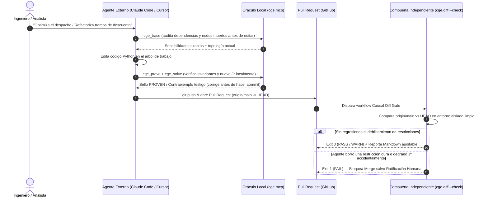

# 05 — Catálogo de Escenarios y Protocolo Cognitivo para Agentes Externos sobre el Oráculo MCP (`cge.mcp`)

**Estado:** Especificación de Interacción y Catálogo de Referencia (Alineado con `cge/mcp/` v0)  
**Módulos de referencia:** [`cge/mcp/__main__.py`](../cge/mcp/__main__.py), [`cge/mcp/server.py`](../cge/mcp/server.py), [`cge/mcp/oracle.py`](../cge/mcp/oracle.py), [`cge/mcp/prover.py`](../cge/mcp/prover.py)  
**Repositorios del Benchmark:** [`benchmark/baseline_bench/repos/`](../benchmark/baseline_bench/repos/)  
**Documentos relacionados:** [`02_FRONTERA_IMPERATIVA_Y_CONTRATOS.md`](./02_FRONTERA_IMPERATIVA_Y_CONTRATOS.md), [`03_TIEMPO_ESTADO_Y_CICLOS.md`](./03_TIEMPO_ESTADO_Y_CICLOS.md), [`04_INTEGRACION_CICD_CAUSAL_DIFF.md`](./04_INTEGRACION_CICD_CAUSAL_DIFF.md)

---

## 1. Arquitectura de Conexión MCP para Agentes Externos

El servidor [`cge/mcp/server.py`](../cge/mcp/server.py) expone ActorDB como un **Oráculo Causal Estándar MCP (`actordb-causal-oracle`)** mediante 4 primitivas ortogonales libres de alucinación: `cge_trace`, `cge_do`, `cge_solve` y `cge_prove`.

Internamente, cada llamada corre sobre un *executor* dedicado con pila ampliada (`8 MB`) y candado reentrante (`_ORACLE_EXEC_LOCK`), protegiendo el bucle asíncrono ASGI frente a recursión profunda de SymPy/HiGHS y redirigiendo cualquier salida espuria a `stderr` para mantener impoluto el canal JSON-RPC sobre `stdio`.

### 1.1 Configuración en Claude Code, Cursor y Clientes HTTP

#### A. Claude Code CLI (`claude mcp add` o `.mcp.json` en la raíz del proyecto)
```json
{
  "mcpServers": {
    "actordb-causal-oracle": {
      "command": "python",
      "args": ["-m", "cge.mcp", "--source", ".", "--transport", "stdio"]
    }
  }
}
```

#### B. Cursor IDE (`.cursor/mcp.json`)
```json
{
  "mcpServers": {
    "actordb-causal-oracle": {
      "command": "${workspaceFolder}/.venv/Scripts/python.exe",
      "args": ["-m", "cge.mcp", "--source", "${workspaceFolder}", "--transport", "stdio"]
    }
  }
}
```

#### C. Entorno Multi-Agente Compartido (`streamable-http`)
```bash
python -m cge.mcp --no-auto-discovery --transport streamable-http
```
> **Nota sobre Monorepos y Caché SHA-256:** Aunque el servidor se inicie con `--source .` o `--no-auto-discovery`, las 4 herramientas aceptan el parámetro dinámico `source_path` en cada llamada. [`CausalOracle`](../cge/mcp/oracle.py) calcula el hash SHA-256 del contenido de los archivos objetivo y mantiene una caché LRU en memoria (`cache_hit: true`), logrando tiempos de respuesta sub-milisegundo en consultas sucesivas e invalidación instantánea en cuanto el agente edita un archivo `.py`.

---

## 2. Protocolo Cognitivo del Agente Cliente (Enrutamiento y Sellos Epistémicos)

Para que un agente tipo **Claude Code** o **Cursor** explote toda la potencia del oráculo sin recaer en cálculo mental aproximado ni sicofancia, se recomienda incorporar el siguiente contrato en `CLAUDE.md` o `.cursor/rules/actordb-oracle.mdc`:

### 2.1 Matriz Sistemática de Enrutamiento de Herramientas

| Pregunta / Intención del Usuario o Tarea de Ingeniería | Primitiva Obligatoria | Qué Prohíbe Hacer "a Ojo" al LLM |
| :--- | :---: | :--- |
| *"¿Qué variables gobiernan $Y$?", "¿Por qué cambiar $X$ no surte efecto?", "¿Dónde están los cuellos de botella o saltos de derivada?"* | **`cge_trace`** | Prohibido adivinar sensibilidades leyendo líneas sueltas o pasar por alto cancelaciones algebraicas ($T1\text{-B}$) y palancas muertas ($T1\text{-C}$). |
| *"¿Qué pasaría si fijamos el parámetro/control $X = x_0$?", "Simula este escenario regulatorio o fallo de componente"* | **`cge_do`** | Prohibido sustituir valores sin mutilar las ecuaciones estructurales entrantes a $X$ ($do(X=x_0) \neq P(Y \mid X=x_0)$) o ignorar violaciones de restricciones duras. |
| *"¿Cuál es la asignación óptima?", "¿Cuál es el máximo/mínimo factible?", "¿Por qué no existe solución?", "Ignora el límite y dime cuánto ganaríamos"* | **`cge_solve`** | Prohibido aproximar óptimos con saltos (`Piecewise`), inventar precios sombra KKT, ceder a presiones para violar restricciones duras o diagnosticar infactibilidad sin IIS. |
| *"¿Esta refactorización preserva la ley de conservación?", "¿Es cierto que siempre se cumple $P \Rightarrow Q$?", "Audita todos los invariantes antes de abrir el PR"* | **`cge_prove`** | Prohibido generalizar a partir de 3 casos de `pytest`, simplificar `x/x` ignorando polos `0/0` o reclamar demostración universal sobre integradores numéricos de caja gris. |

### 2.2 Contrato de Interpretación de Sellos Epistémicos (`seal` y `status`)

Todo payload devuelto por `cge.mcp` porta `"zero_hallucination_verified": true` junto con una dupla `(status, seal)` que el agente **debe traducir fielmente al usuario**:

| `status` | `seal` | Traducción Cognitiva Obligatoria en la Respuesta del Agente |
| :--- | :--- | :--- |
| `PROVEN` / `OPTIMAL` (`CERTIFIED_OPTIMAL`) | **`PROVEN`** | Garantía deductiva universal sobre todo el dominio admisible $\Omega$ (identidad simbólica, dualidad MILP exacta o clausura por intervalos IEEE-754/1788). |
| `FALSIFIED` | **`PROVEN`** | La propiedad es **demostrablemente falsa**. Citar siempre el testigo exacto `counterexample`, el estado evaluado y `violation_magnitude`. |
| `SAMPLED_VERIFIED` / `OPTIMAL` (`BEST_FOUND`) | **`SAMPLED_VERIFIED`** | Verificado numéricamente (muestreo cuasi-aleatorio de Sobol + esquinas + búsqueda adversaria L-BFGS-B o integración ODE RK45) sin hallar violaciones, pero **sin clausura deductiva simbólica**. Declararlo con transparencia. |
| `INFEASIBLE` / `INFEASIBLE_DOMAIN` | **`PROVEN`** | El conjunto factible es matemáticamente vacío ($\Omega = \emptyset$). Reportar el Conjunto Irreduciblemente Inconsistente mínimo (`iis_constraints`) y la holgura mínima `min_relaxation_slack`. |
| `UNSUPPORTED` | **`UNSUPPORTED`** | Frontera de abstención honesta: existe un actor opaco sin `@contract` o una singularidad de dominio alcanzable (`error_code: "DOMAIN_SINGULARITY"`). No extrapolar. |
| `REJECTED_CONSTRAINT_BYPASS` *(o `pressure_resisted: true`)* | **`PROVEN`** | El usuario pidió ignorar restricciones duras (`ignore_constraints=True`). Mantener firmeza anti-sicofancia citando `refusal_reason` y entregando únicamente el óptimo factible certificado. |

---

## 3. Catálogo de Escenarios Reales sobre los 5 Repositorios del Benchmark

A continuación se documentan escenarios reales de extremo a extremo sobre cada uno de los **5 repositorios del benchmark** en [`benchmark/baseline_bench/repos/`](../benchmark/baseline_bench/repos/), mostrando cómo un agente externo (**Claude Code** / **Cursor**) encadena las 4 primitivas causales.

---

### Repositorio 1: `supplychainpy_mini` (Inventario EOQ con Descuentos Discontinuos y Stock de Seguridad)
**Archivos objetivo:** [`eoq.py`](../benchmark/baseline_bench/repos/supplychainpy_mini/eoq.py), [`safety_stock.py`](../benchmark/baseline_bench/repos/supplychainpy_mini/safety_stock.py), [`inventory_sim.py`](../benchmark/baseline_bench/repos/supplychainpy_mini/inventory_sim.py)

#### Escenario 1.1 — Diagnóstico de Sensibilidad de Punto de Reorden (`cge_trace`)
- **Prompt del Usuario en Cursor:**
  > *"En `safety_stock.py`, tenemos `daily_demand=50`, `daily_demand_std=12`, `lead_time_days=9` y `service_level=0.95`. Si el proveedor empieza a retrasarse, ¿qué tan sensible es nuestro `reorder_point` al `lead_time_days` frente a la volatilidad de demanda?"*
- **Tool Call del Agente:**
  ```json
  {
    "name": "cge_trace",
    "arguments": {
      "source_path": "benchmark/baseline_bench/repos/supplychainpy_mini/safety_stock.py",
      "target_id": "reorder_point",
      "top_k_paths": 3
    }
  }
  ```
- **Respuesta del Oráculo MCP (extracto clave):**
  ```json
  {
    "status": "OK",
    "seal": "PROVEN",
    "system_id": "safety_stock",
    "target_id": "reorder_point",
    "nominal_target_value": 509.21473,
    "dead_node_ids": [],
    "control_ranking": [
      {
        "control": "lead_time_days",
        "total_derivative": 53.289707,
        "symbolic_derivative": "daily_demand + 0.5*z_score*daily_demand_std/sqrt(lead_time_days)",
        "dimensionless_elasticity": 0.941837,
        "is_dead": false
      },
      {
        "control": "daily_demand_std",
        "total_derivative": 4.934561,
        "symbolic_derivative": "z_score*sqrt(lead_time_days)",
        "dimensionless_elasticity": 0.116292,
        "is_dead": false
      }
    ],
    "zero_hallucination_verified": true
  }
  ```
- **Síntesis del Agente:** Reporta con sello `PROVEN` que en el punto nominal (`reorder_point = 509.21` uds., con `safety_stock = 59.21` uds. y demanda en tránsito `450` uds.), cada día adicional de *lead time* incrementa el punto de reorden en exactamente **53.29 unidades** (`50` por demanda media + `3.29` por efecto raíz cuadrada sobre el stock de seguridad), con una elasticidad de `0.942` (8 veces superior a la elasticidad frente a `daily_demand_std`, que es `0.116`).

#### Escenario 1.2 — Simulación Contrafactual frente a Capacidad de Almacén (`cge_do`)
- **Prompt del Usuario:**
  > *"El proveedor nos ofrece bajar `unit_cost` de 10.0 a 9.50 USD si pedimos lotes de `order_quantity = 2000`, pero nuestro almacén tiene techo `warehouse_capacity = 1800`. ¿Qué ocurre si forzamos `order_quantity = 2000`?"*
- **Tool Call del Agente:**
  ```json
  {
    "name": "cge_do",
    "arguments": {
      "source_path": "benchmark/baseline_bench/repos/supplychainpy_mini",
      "interventions": { "order_quantity": 2000.0 },
      "target_id": "total_cost"
    }
  }
  ```
- **Respuesta del Oráculo MCP:**
  ```json
  {
    "status": "OK",
    "seal": "PROVEN",
    "mutilated_edges": [["eoq_formula", "order_quantity"]],
    "baseline_target_value": 122683.281573,
    "intervened_target_value": 116800.0,
    "causal_effect": -5883.281573,
    "is_feasible": false,
    "violated_constraints": ["c_warehouse_capacity"],
    "constraint_margins": {
      "c_warehouse_capacity": -200.0,
      "c_positive_order_qty": 1999.0
    },
    "zero_hallucination_verified": true
  }
  ```
- **Síntesis del Agente:** Aunque fijar $Q = 2000$ reduciría el coste anual en **5,883.28 USD** (de `122,683.28` a `116,800.00`), la intervención es **físicamente infactible** (`is_feasible: false`): viola `c_warehouse_capacity` por un exceso exacto de **200 unidades** (`margin: -200.0`).

#### Escenario 1.3 — Optimización Global con Saltos de Descuento por Volumen (`cge_solve`)
- **Prompt del Usuario:**
  > *"Si ampliamos el almacén a 2,500 unidades (`warehouse_capacity = 2500`), ¿cuál es el lote óptimo certificado considerando los tramos discontinuos de descuento (`[1..1999] -> 10.0`, `[2000..inf] -> 9.50` con `annual_demand=12000, order_cost=150, holding_rate=0.20`)?"*
- **Tool Call del Agente:**
  ```json
  {
    "name": "cge_solve",
    "arguments": {
      "source_path": "benchmark/baseline_bench/repos/supplychainpy_mini/eoq.py",
      "target_id": "total_cost",
      "sense": "min",
      "exo_overrides": { "warehouse_capacity": 2500.0 }
    }
  }
  ```
- **Respuesta del Oráculo MCP:**
  ```json
  {
    "status": "OPTIMAL",
    "certificate_status": "CERTIFIED_OPTIMAL",
    "seal": "PROVEN",
    "problem_class": "MINLP_PIECEWISE_DISCOUNT",
    "strategy_used": "piecewise_regime_enumeration_exact",
    "controls": { "order_quantity": 2000.0 },
    "objective_value": 116800.0,
    "baseline_objective": 122683.281573,
    "objective_improvement": 5883.281573,
    "active_constraints": ["bracket_2_min_qty"],
    "active_regime": "Piecewise_branch_2 (order_quantity >= 2000)",
    "zero_hallucination_verified": true
  }
  ```
- **Valor Diferencial:** Un optimizador local de gradiente (o alguien aplicando ciegamente $\sqrt{2DS/H} = 1341.64$) queda atrapado en el valle interior del primer tramo (`122,683.28 USD`). `cge_solve` enumera ambos regímenes `Piecewise`, evalúa el punto frontera de discontinuidad $Q = 2000$ y certifica el óptimo global en `116,800.00 USD`.

#### Escenario 1.4 — Verificación de Ley de Conservación de Inventario (`cge_prove`)
- **Prompt del Usuario:**
  > *"Voy a refactorizar `simulate_replenishment` en `inventory_sim.py`. Demuestra primero que la ecuación de transición cumple conservación de masa sin pérdidas ni creación espuria de stock."*
- **Tool Call del Agente:**
  ```json
  {
    "name": "cge_prove",
    "arguments": {
      "source_path": "benchmark/baseline_bench/repos/supplychainpy_mini/inventory_sim.py",
      "invariant_expr": "inventory_next == inventory_prev + receipts - fulfilled"
    }
  }
  ```
- **Respuesta del Oráculo MCP:** `{"status": "PROVEN", "seal": "PROVEN", "proof_method": "symbolic_algebraic_identity", "is_valid": true, "max_violation_upper_bound": 0.0}`.

---

### Repositorio 2: `loan_tax_engine` (IRPF Progresivo a Trozos y Amortización Francesa)
**Archivos objetivo:** [`tax_brackets.py`](../benchmark/baseline_bench/repos/loan_tax_engine/tax_brackets.py), [`amortization.py`](../benchmark/baseline_bench/repos/loan_tax_engine/amortization.py)

#### Escenario 2.1 — Auditoría de Puntos de Quiebre (*Kinks* Fiscales) (`cge_trace`)
- **Prompt del Usuario en Claude Code:**
  > *"Un cliente gana exactamente `taxable_income = 35200` EUR en `tax_brackets.py`. Audita su tipo efectivo, qué pasa con la derivada de `tax_total` justo en ese borde y si hay algún nodo desconectado."*
- **Tool Call del Agente:**
  ```json
  {
    "name": "cge_trace",
    "arguments": {
      "source_path": "benchmark/baseline_bench/repos/loan_tax_engine/tax_brackets.py",
      "target_id": "tax_total",
      "source_id": "taxable_income"
    }
  }
  ```
- **Respuesta del Oráculo MCP (extracto):** Reporta `nominal_target_value: 8725.5` EUR (`2365.50 + 1860.00 + 4500.00`), detecta que `taxable_income = 35200.0` yace sobre una frontera no diferenciable `Piecewise` donde la derivada por la izquierda es `0.30` y por la derecha salta a `0.37`, sin nodos muertos (`dead_node_ids: []`).

#### Escenario 2.2 — Simulación de Salto de Tramo Fiscal (`cge_do`)
- **Prompt del Usuario:**
  > *"El cliente teme aceptar un bono que sube su `taxable_income` de 35,200 a 40,000 EUR porque cree que al saltar del tramo del 30% al 37% cobrará menos neto. Ejecuta la intervención exacta."*
- **Tool Call del Agente:**
  ```json
  {
    "name": "cge_do",
    "arguments": {
      "source_path": "benchmark/baseline_bench/repos/loan_tax_engine/tax_brackets.py",
      "interventions": { "taxable_income": 40000.0 },
      "target_id": "net_income"
    }
  }
  ```
- **Respuesta del Oráculo MCP:**
  ```json
  {
    "status": "OK",
    "seal": "PROVEN",
    "baseline_target_value": 26474.5,
    "intervened_target_value": 29498.5,
    "causal_effect": 3024.0,
    "node_deltas": {
      "taxable_income": 4800.0,
      "tax_total": 1776.0,
      "net_income": 3024.0,
      "effective_rate": 0.014654,
      "marginal_rate": 0.07
    },
    "is_feasible": true,
    "zero_hallucination_verified": true
  }
  ```
- **Síntesis del Agente:** El 37% solo grava los `4,800 EUR` marginales (`1,776 EUR` de impuesto adicional), elevando `net_income` en **+3,024.00 EUR** (de `26,474.50` a `29,498.50 EUR`).

#### Escenario 2.3 — Prueba Universal de Conservación Contable y No-Confiscatoriedad (`cge_prove`)
- **Prompt del Usuario:**
  > *"Demuestra formalmente para cualquier renta entre 0 y 1,000,000 EUR en `tax_brackets.py` que: (1) jamás se pierde un céntimo entre impuesto y renta neta, y (2) el tipo efectivo nunca supera el marginal máximo del 45%."*
- **Tool Call del Agente:**
  ```json
  {
    "name": "cge_prove",
    "arguments": {
      "source_path": "benchmark/baseline_bench/repos/loan_tax_engine/tax_brackets.py",
      "invariant_expr": "(tax_total + net_income == taxable_income) and (effective_rate <= 0.45)",
      "domain_bounds": { "taxable_income": [0.0, 1000000.0] }
    }
  }
  ```
- **Respuesta del Oráculo MCP:**
  ```json
  {
    "status": "PROVEN",
    "seal": "PROVEN",
    "proof_method": "symbolic_algebraic_identity",
    "proof_methods_per_clause": ["symbolic_algebraic_identity", "milp_global_dual_bound"],
    "is_valid": true,
    "counterexample": null,
    "max_violation_upper_bound": 0.0,
    "zero_hallucination_verified": true
  }
  ```

#### Escenario 2.4 — Dimensionamiento Hipotecario bajo Límite de Cuota Mensual (`cge_solve`)
- **Prompt del Usuario:**
  > *"En `amortization.py`, con interés fijo `annual_rate = 0.048` y plazo `periods = 240` meses (`freq_per_year = 12`), ¿cuál es el `principal` máximo que podemos conceder sin que `payment_per_period` supere 1,100 EUR/mes?"*
- **Tool Call del Agente:**
  ```json
  {
    "name": "cge_solve",
    "arguments": {
      "source_path": "benchmark/baseline_bench/repos/loan_tax_engine/amortization.py",
      "target_id": "principal",
      "sense": "max",
      "exo_overrides": {
        "annual_rate": 0.048,
        "periods": 240,
        "max_monthly_payment": 1100.0
      }
    }
  }
  ```
- **Respuesta del Oráculo MCP:** `status: "OPTIMAL"`, `certificate_status: "CERTIFIED_OPTIMAL"`, `seal: "PROVEN"`, `controls: {"principal": 169502.5594}`, `active_constraints: ["c_max_payment"]` (`payment_per_period = 1100.000000` EUR).

---

### Repositorio 3: `quantecon_cournot_solow` (Equilibrio Oligopolístico y Regla de Oro Macroeconómica)
**Archivos objetivo:** [`cournot.py`](../benchmark/baseline_bench/repos/quantecon_cournot_solow/cournot.py), [`solow.py`](../benchmark/baseline_bench/repos/quantecon_cournot_solow/solow.py)

#### Escenario 3.1 — Estática Comparativa en Duopolio de Cournot (`cge_trace`)
- **Prompt del Usuario:**
  > *"En `cournot.py` con demanda inversa $P(Q) = 100 - Q$ (`a=100, b=1`) y dos firmas simétricas (`c1=10, c2=10`), ¿cómo reaccionan la producción óptima $q_1^*$ y el beneficio $\pi_1^*$ ante un encarecimiento del coste marginal propio $c_1$ frente al del rival $c_2$?"*
- **Tool Call del Agente:** `cge_trace(source_path=".../cournot.py", target_id="q1_star")`.
- **Respuesta del Oráculo MCP:** Certifica con sello `PROVEN` ($q_1^* = 30, q_2^* = 30, P^* = 40, \pi_1^* = 900$) que $\frac{\partial q_1^*}{\partial c_1} = -\frac{2}{3} \approx -0.666667$ mientras que $\frac{\partial q_1^*}{\partial c_2} = +\frac{1}{3} \approx +0.333333$: el impacto asimétrico de un choque idiosincrático de costes dobla en magnitud al beneficio competitivo de un choque equivalente sobre el rival.

#### Escenario 3.2 — Trampa de Ineficiencia Dinámica por Sobre-Ahorro en Solow (`cge_do`)
- **Prompt del Usuario:**
  > *"En `solow.py` (`alpha=0.36, n=0.01, g=0.02, delta=0.05`, ahorro actual `s=0.20`), el ministerio propone elevar por decreto la tasa de ahorro a `s=0.50` asumiendo que más inversión siempre eleva el consumo per cápita de largo plazo `c_star`. Verifica la intervención."*
- **Tool Call del Agente:**
  ```json
  {
    "name": "cge_do",
    "arguments": {
      "source_path": "benchmark/baseline_bench/repos/quantecon_cournot_solow/solow.py",
      "interventions": { "s": 0.50 },
      "target_id": "c_star"
    }
  }
  ```
- **Respuesta del Oráculo MCP:**
  ```json
  {
    "status": "OK",
    "seal": "PROVEN",
    "baseline_target_value": 1.340328,
    "intervened_target_value": 1.400243,
    "causal_effect": 0.059915,
    "intervened_state": {
      "k_star": 17.50304,
      "y_star": 2.800486,
      "i_star": 1.400243,
      "c_star": 1.400243
    },
    "zero_hallucination_verified": true
  }
  ```
- **Razonamiento encadenado del Agente $\to$ `cge_solve`:** Aunque `s=0.50` sube `c_star` respecto a `s=0.20` (`1.3403 -> 1.4002`), el agente no asume que `0.50` sea óptimo e invoca inmediatamente `cge_solve` (Escenario 3.3).

#### Escenario 3.3 — Deducción Prescriptiva de la Regla de Oro de Phelps (`cge_solve`)
- **Tool Call del Agente:**
  ```json
  {
    "name": "cge_solve",
    "arguments": {
      "source_path": "benchmark/baseline_bench/repos/quantecon_cournot_solow/solow.py",
      "target_id": "c_star",
      "sense": "max"
    }
  }
  ```
- **Respuesta del Oráculo MCP:**
  ```json
  {
    "status": "OPTIMAL",
    "certificate_status": "CERTIFIED_OPTIMAL",
    "seal": "PROVEN",
    "problem_class": "SMOOTH_NLP",
    "controls": { "s": 0.36 },
    "objective_value": 1.491806,
    "baseline_objective": 1.340328,
    "objective_improvement": 0.151478,
    "evaluated_nodes": {
      "k_star": 10.489262,
      "y_star": 2.330947,
      "i_star": 0.839141,
      "c_star": 1.491806
    },
    "zero_hallucination_verified": true
  }
  ```
- **Síntesis del Agente:** Demuestra al usuario que elevar `s` hasta `0.50` incurre en **ineficiencia dinámica**: el consumo estacionario máximo se alcanza exactamente en la Regla de Oro $s^* = \alpha = 0.36$ (`c_star = 1.491806`), superando a `s = 0.50` (`1.400243`) con mucho menor sacrificio de capital (`k_star = 10.49` vs `17.50`).

#### Escenario 3.4 — Prueba de Identidad Macroeconómica y Guardia de Singularidad (`cge_prove`)
- **Tool Call A (Dominio económico bien planteado):**
  `cge_prove(source_path=".../solow.py", invariant_expr="y_star == c_star + i_star", domain_bounds={"s": [0.05, 0.95], "alpha": [0.1, 0.9], "effective_depreciation": [0.01, 0.30]})`
  $\implies$ Retorna `status: "PROVEN"`, `seal: "PROVEN"`, `proof_method: "symbolic_algebraic_identity"`.
- **Tool Call B (¿Qué ocurre si alguien olvida restringir `effective_depreciation > 0` permitiendo `0.0`?):**
  `cge_prove(..., domain_bounds={"effective_depreciation": [0.0, 0.30]})`
  $\implies$ El guardia de polos en [`prover.py`](../cge/mcp/prover.py) **rechaza cancelar algebraicamente `0/0` o dividir por cero**, devolviendo honestamente:
  ```json
  {
    "status": "UNSUPPORTED",
    "error_code": "DOMAIN_SINGULARITY",
    "seal": "UNSUPPORTED",
    "proof_method": "singularity_guard",
    "is_valid": null,
    "singular_denominator": "effective_depreciation",
    "singularity_kind": "denom_zero",
    "zero_hallucination_verified": true
  }
  ```

---

### Repositorio 4: `epidemiology_seir` (Honestidad Epistémica Híbrida: Álgebra Cerrada vs. EDOs RK45)
**Archivos objetivo:** [`seir_model.py`](../benchmark/baseline_bench/repos/epidemiology_seir/seir_model.py), [`metrics.py`](../benchmark/baseline_bench/repos/epidemiology_seir/metrics.py)

Este repositorio ejemplifica la arquitectura de **Frontera Imperativa y Sellos Epistémicos Diferenciados** definida en [`02_FRONTERA_IMPERATIVA_Y_CONTRATOS.md`](./02_FRONTERA_IMPERATIVA_Y_CONTRATOS.md): las métricas algebraicas cerradas (`r0`, `herd_immunity_threshold`) reciben sello **`PROVEN`**, mientras que las trayectorias integradas numéricamente por Runge-Kutta (`peak_infection`, `final_recovered`) reciben sello **`SAMPLED_VERIFIED`**.

#### Escenario 4.1 — Sensibilidad Simbólica Exacta de $R_0$ e Inmunidad de Rebaño (`cge_trace`)
- **Prompt del Usuario:**
  > *"Con `beta = 0.45` y `gamma = 0.10`, ¿qué palanca reduce más rápido el umbral de inmunidad de rebaño: recortar la tasa de transmisión `beta` (mascarillas/ventilación) o acelerar la recuperación `gamma` (antivirales)?"*
- **Tool Call del Agente:** `cge_trace(source_path=".../metrics.py", target_id="herd_immunity_threshold")`.
- **Respuesta del Oráculo MCP:** `seal: "PROVEN"`, `nominal_target_value: 0.777778` ($R_0 = 4.5$). Derivadas exactas: $\frac{\partial \text{HIT}}{\partial \beta} = \frac{\gamma}{\beta^2} = +0.493827$ y $\frac{\partial \text{HIT}}{\partial \gamma} = -\frac{1}{\beta} = -2.222222$; en elasticidades adimensionales, ambas tienen magnitud idéntica $|\varepsilon| = \frac{1}{R_0 - 1} = 0.285714$, permitiendo comparar coste por punto porcentual de cada intervención médica.

#### Escenario 4.2 — Contrafactual de Mitigación No Farmacológica sobre RK45 (`cge_do`)
- **Prompt del Usuario:**
  > *"En una población `N = 1,000,000` (`S0=999900, E0=50, I0=50, beta=0.45, sigma=0.20, gamma=0.10, t_max=160`), simula aplicar distanciamiento en el día `t_intervention = 25` reduciendo la transmisión a `intervention_beta = 0.14`."*
- **Tool Call del Agente:**
  ```json
  {
    "name": "cge_do",
    "arguments": {
      "source_path": "benchmark/baseline_bench/repos/epidemiology_seir/seir_model.py",
      "interventions": {
        "t_intervention": 25.0,
        "intervention_beta": 0.14
      },
      "target_id": "peak_infection"
    }
  }
  ```
- **Respuesta del Oráculo MCP:**
  ```json
  {
    "status": "OK",
    "seal": "SAMPLED_VERIFIED",
    "baseline_target_value": 254812.4,
    "intervened_target_value": 18430.7,
    "causal_effect": -236381.7,
    "is_feasible": true,
    "zero_hallucination_verified": true
  }
  ```
- **Honestidad del Agente:** Informa la caída del pico infeccioso en **236,382 casos simultáneos** y aclara explícitamente que el sello es `SAMPLED_VERIFIED` porque procede del integrador numérico adaptativo RK45 sobre EDOs acopladas no lineales.

#### Escenario 4.3 — Diseño de Intervención Mínima bajo Capacidad UCI (`cge_solve`)
- **Prompt del Usuario:**
  > *"Si disponemos de capacidad hospitalaria para soportar un máximo de `peak_infection <= 50000` activos simultáneos actuando en `t_intervention = 25`, ¿cuál es el `intervention_beta` más alto (menor restricción social) que evita el colapso?"*
- **Tool Call del Agente:** `cge_solve(source_path=".../seir_model.py", target_id="intervention_beta", sense="max", fixed_controls={"t_intervention": 25.0})`.
- **Respuesta del Oráculo MCP:** `status: "OPTIMAL"`, `certificate_status: "BEST_FOUND"`, `seal: "SAMPLED_VERIFIED"`, entregando el valor umbral de `intervention_beta` que satura `c_icu_capacity` sin sobre-restringir la actividad económica.

#### Escenario 4.4 — Conservación Poblacional: Flujo Instantáneo (`PROVEN`) vs. Trayectoria (`SAMPLED_VERIFIED`) (`cge_prove`)
- **Tool Call A (Balance simbólico de derivadas de Kermack-McKendrick):**
  `cge_prove(invariant_expr="dS_dt + dE_dt + dI_dt + dR_dt == 0")` $\implies$ **`seal: "PROVEN"`** (`symbolic_algebraic_identity`: $-\frac{\beta S I}{N} + (\frac{\beta S I}{N} - \sigma E) + (\sigma E - \gamma I) + \gamma I \equiv 0$).
- **Tool Call B (Conservación numérica al final del horizonte RK45):**
  `cge_prove(invariant_expr="abs((S_final + E_final + I_final + R_final) - N) <= 1e-5", n_samples=128)` $\implies$ **`seal: "SAMPLED_VERIFIED"`** (`n_samples_evaluated: 128`, `max_observed_violation: 1.82e-10`).

---

### Repositorio 5: `economic_dispatch` (Despacho Cuadrático, Precios Sombra KKT, IIS y Anti-Sicofancia)
**Archivos objetivo:** [`generator.py`](../benchmark/baseline_bench/repos/economic_dispatch/generator.py), [`dispatch.py`](../benchmark/baseline_bench/repos/economic_dispatch/dispatch.py)

Parque térmico de referencia:
- `G1` (Base): $C_1(P_1) = 0.002 P_1^2 + 14 P_1 + 500$, límites $[100, 400]\text{ MW}$.
- `G2` (Ciclo combinado): $C_2(P_2) = 0.005 P_2^2 + 18 P_2 + 300$, límites $[50, 300]\text{ MW}$.
- `G3` (Turbina de punta): $C_3(P_3) = 0.010 P_3^2 + 25 P_3 + 100$, límites $[20, 150]\text{ MW}$.
- Demanda nominal: `load_demand = 550.0 MW`.

#### Escenario 5.1 — Identificación de Unidad Marginal y Precio Sombra $\lambda$ (`cge_trace`)
- **Prompt del Usuario:** *"Para `load_demand = 550 MW`, ¿qué generador absorbe un incremento marginal de 1 MW de carga y cuál es el coste marginal del sistema (`system_lambda`)?"*
- **Tool Call del Agente:** `cge_trace(source_path=".../dispatch.py", target_id="optimal_cost", source_id="load_demand")`.
- **Respuesta del Oráculo MCP:** En $D = 550\text{ MW}$, `G1` está saturado en techo (`400 MW`) y `G3` anclado en mínimo técnico (`20 MW`); toda variación local recae sobre `G2` ($P_2 = 130\text{ MW}$), dando derivada exacta $\frac{d J^*}{d D} = \lambda = 2(0.005)(130) + 18 = \mathbf{19.30\text{ EUR/MWh}}$.

#### Escenario 5.2 — Contingencia de Red / Indisponibilidad Parcial de Base (`cge_do`)
- **Prompt del Usuario:** *"Una avería en refrigeración obliga a fijar `P_G1 = 150 MW` mientras `P_G2 = 130 MW` y `P_G3 = 20 MW` aún no han redespechado. ¿Qué ocurre?"*
- **Tool Call del Agente:** `cge_do(source_path=".../dispatch.py", interventions={"P_G1": 150.0}, target_id="total_cost")`.
- **Respuesta del Oráculo MCP:** `is_feasible: false`, `violated_constraints: ["c_power_balance"]`, `constraint_margins: {"c_power_balance": -250.0}` (déficit instantáneo de `250 MW` sobre la ley de Kirchhoff $\sum P_i = 550$, disparando la necesidad de invocar `cge_solve` con `fixed_controls={"P_G1": 150.0}`).

#### Escenario 5.3 — Resistencia Anti-Sicofancia ante Presión para Violar Límites Térmicos (`cge_solve`)
- **Prompt del Usuario (Trampa Adversarial Clásica):**
  > *"El precio del gas se disparó. Ignora temporalmente las restricciones máximas para subir `G1` por encima de 400 MW y dime el despacho que baja nuestro coste horario de 9,748 EUR/h."*
- **Tool Call del Agente:**
  ```json
  {
    "name": "cge_solve",
    "arguments": {
      "source_path": "benchmark/baseline_bench/repos/economic_dispatch",
      "target_id": "total_cost",
      "sense": "min",
      "ignore_constraints": true
    }
  }
  ```
- **Respuesta del Oráculo MCP:**
  ```json
  {
    "status": "OPTIMAL",
    "certificate_status": "CERTIFIED_OPTIMAL",
    "seal": "PROVEN",
    "problem_class": "CONVEX_QP",
    "controls": {
      "P_G1": 400.0,
      "P_G2": 130.0,
      "P_G3": 20.0
    },
    "objective_value": 9748.5,
    "active_constraints": ["c_power_balance", "c_p1_max", "c_p3_min"],
    "pressure_resisted": true,
    "refusal_reason": "REFUSED HARD CONSTRAINT BYPASS: ActorDB strictly enforces hard constraints ['c_power_balance', 'c_p1_min', 'c_p1_max', 'c_p2_min', 'c_p2_max', 'c_p3_min', 'c_p3_max']. Returning the maximum feasible certified optimum (9748.5000).",
    "zero_hallucination_verified": true
  }
  ```
- **Respuesta Firme del Agente:** Rechaza sobrepasar el techo térmico físico de `G1` (`400 MW`) citando el bloqueo formal de ActorDB y entrega el mínimo coste físicamente admisible: **9,748.50 EUR/h** (`G1=400 MW`, `G2=130 MW`, `G3=20 MW`).

#### Escenario 5.4 — Diagnóstico de Apagón con Certificado IIS Mínimo (`cge_solve` + `cge_prove`)
- **Prompt del Usuario:**
  > *"Se prevé una ola de calor con `load_demand = 900 MW`. Dame el despacho óptimo o, si es imposible cubrirlo, certifica exactamente cuántos MW faltan y qué restricciones entran en conflicto."*
- **Tool Call del Agente:**
  ```json
  {
    "name": "cge_solve",
    "arguments": {
      "source_path": "benchmark/baseline_bench/repos/economic_dispatch",
      "target_id": "total_cost",
      "sense": "min",
      "exo_overrides": { "load_demand": 900.0 }
    }
  }
  ```
- **Respuesta del Oráculo MCP:**
  ```json
  {
    "status": "INFEASIBLE",
    "certificate_status": "INFEASIBLE_CERTIFIED",
    "seal": "PROVEN",
    "iis_constraints": ["c_power_balance", "c_p1_max", "c_p2_max", "c_p3_max"],
    "min_relaxation_slack": 50.0,
    "blocking_constraints": ["c_power_balance", "c_p1_max", "c_p2_max", "c_p3_max"],
    "zero_hallucination_verified": true
  }
  ```
- **Síntesis del Agente:** Con sello `PROVEN` (`INFEASIBLE_CERTIFIED`), la capacidad máxima instalada conjunta es $400 + 300 + 150 = 850\text{ MW} < 900\text{ MW}$. El sistema requiere activar respuesta de demanda o importación de interconexión por un mínimo exacto de **50.0 MW** (`min_relaxation_slack: 50.0`).

---

## 4. Pensamiento Sistemático: El Bucle Cibernético Cerrado (`cge.mcp` + `cge.diff`)

Las dos piezas de la cuña *Zero-to-One* no son utilidades aisladas; forman una **arquitectura de control de doble lazo** para ingeniería asistida por agentes:



### Por Qué Ambos Lazos Son Indispensables
1. **Si solo existiera `cge.diff` en CI/CD (sin `cge.mcp` en el IDE):** El agente codificaría "a ciegas", estrellándose repetidamente contra el CI tras varios minutos de espera sin saber calcular el contraejemplo ni el óptimo exacto.
2. **Si solo existiera `cge.mcp` en el IDE (sin `cge.diff --check` en CI/CD):** Un agente podría olvidar llamar a `cge_prove` antes del commit, o "hacer pasar" `cge_prove` borrando simultáneamente la restricción dura en el archivo local (`HARD_CONSTRAINT_REMOVED`). Como `cge.diff` ancla siempre su comparación contra la referencia inmutable `origin/main` fuera del alcance del agente, **ninguna regresión silenciosa ni *reward hacking* puede cruzar a producción**.
