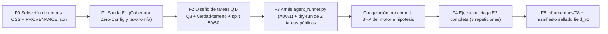

# 07. HITO ESTRATÉGICO: PRUEBA DE FUEGO EXTERNA (COBERTURA ZERO-CONFIG Y BENCHMARK A/B CON AGENTE LLM REAL)

> **Estado:** `Draft — decisiones pendientes (§9)` (diseño pre-registrado; aún no se ejecuta ni modifica benchmarks existentes)  
> **Relacionado con:** [`docs/baseline/02_flujo_actual_y_baseline_empirico.md`](baseline/02_flujo_actual_y_baseline_empirico.md), [`docs/baseline/04_marco_de_metricas.md`](baseline/04_marco_de_metricas.md) y [`docs/06_INGESTA_UNIVERSAL_P5_Y_ACTORDB_YAML.md`](06_INGESTA_UNIVERSAL_P5_Y_ACTORDB_YAML.md).

---

## 1. Motivación y Pregunta de Investigación

El estudio fundacional `baseline_v0` demostró la viabilidad matemática del núcleo de ActorDB sobre un arnés determinista y congelado, pero dejó deliberadamente abiertas **dos fronteras empíricas** que deben validarse antes de expandir la teoría hacia actores indexados (`P3`) u orquestación híbrida SMT+NLP (`P4`):

1. **Agentes reales vs. arquetipos simulados:** En `baseline_v0`, los contendientes `B0`–`B2` fueron implementados como arquetipos deterministas offline (sin llamadas a LLM en vivo) para garantizar reproducibilidad sin claves API, mientras que `B3` operó sobre 5 adaptadores artesanales de dominio.
2. **Código externo real vs. paquetes propios:** Aunque `GenericPackageAdapter` + `actordb.yaml` ya compilan paquetes multi-módulo como `examples/saas_unit_economics` y `examples/saas_governed`, falta medir su tasa de éxito real y su impacto en un agente LLM enfrentado a **código Python de terceros no escrito por nosotros**.

### Pregunta central del hito

> *¿Mejora de forma medible un agente LLM real (en precisión exacta, reducción de falsa confianza y eficiencia en tokens) al responder preguntas causales, contrafactuales y de optimización sobre paquetes Python externos nunca vistos, cuando dispone del oráculo MCP `actordb-cge` frente a cuando solo dispone de lectura de archivos e intérprete Python? ¿Y qué fracción de las funciones públicas de ese código externo logra compilar `GenericPackageAdapter` en modo Zero-Config con fidelidad empírica verificada?*

---

## 2. Corpus `R-real-externo` y Reglas de Provenance

El nuevo corpus vivirá en un directorio independiente (`benchmark/field_bench/`), manteniendo **intacto al 100%** el manifiesto sellado `benchmark/baseline_bench/baseline_v0_manifest.json` (41 archivos SHA-256).

### 2.1 Criterios de selección de paquetes OSS

Se seleccionarán entre **3 y 5 paquetes Python open-source** escritos por terceros que cumplan simultáneamente:

- **Dominio cuantitativo o de reglas de decisión:** finanzas/amortización, inventarios/cadena de suministro, despacho/energía, epidemiología compartimental o tarificación/cálculo actuarial.
- **Estructura multi-módulo real:** $\ge 2$ módulos `.py` con funciones públicas numéricas o de decisión y suite de tests propia en origen.
- **Licencia permisiva verificada:** `MIT`, `BSD-2-Clause`, `BSD-3-Clause` o `Apache-2.0`.
- **Candidatos preliminares a auditar en Fase `F0` (no definitivos):** `numpy-financial`, `stockpyl` y paquetes ligeros de epidemiología/pricing o cálculo fiscal/actuarial con dependencias acotadas.

### 2.2 Inmutabilidad y trazabilidad (`PROVENANCE.json`)

Cada paquete seleccionado se congelará como snapshot en `benchmark/field_bench/repos/<pkg_id>/` acompañado de un archivo `PROVENANCE.json` con:

- URL del repositorio upstream y commit SHA exacto clonado.
- Licencia original e inclusión íntegra de su archivo `LICENSE` / `NOTICE`.
- Mapa SHA-256 de todos los archivos `.py` incluidos en el snapshot.

> [!IMPORTANT]
> **Regla Anti-Goodhart de Corpus Externo:** Está estrictamente prohibido editar, simplificar o reescribir el código fuente de los paquetes en `benchmark/field_bench/repos/` para facilitar su ingesta por `GenericPackageAdapter`. Cualquier limitación del compilador debe registrarse honestamente en la sonda `E1` o resolverse mejorando el adaptador genérico antes del corte de congelación (`F3` $\to$ `F4`).

---

## 3. Experimento `E1` — Cobertura Zero-Config Determinista (Sin LLM)

Antes de gastar presupuesto de inferencia LLM, el script determinista `benchmark/field_bench/coverage_probe.py` auditará automáticamente cada paquete del corpus en modo **Capa 1 (Zero-Config puro, sin `actordb.yaml`)**:

1. **Descubrimiento estático:** enumera todas las funciones públicas raíz candidatas del paquete.
2. **Intento de compilación:** clasifica el resultado de `GenericPackageAdapter` para cada entrypoint en:
   - `L0_L1_SYMBOLIC` (ecuaciones simbólicas exactas `PROVEN`),
   - `L2_SAFE_AST_SIMULATION` (intérprete AST acotado `SAMPLED_VERIFIED`), o
   - `UNSUPPORTED` con causa estructurada (`O2_MUTABLE_STATE`, `EXTERNAL_LIB_CALL`, `PANDAS_DATAFRAME`, `DYNAMIC_IO`, `UNBOUNDED_RECURSION`, etc.).
3. **Certificación empírica de fidelidad:** para cada entrypoint compilado, ejecuta el código Python original del paquete frente al grafo compilado sobre una secuencia cuasi-aleatoria de Sobol dentro del dominio válido y verifica:
   $$\max_{k} \frac{|y_{\text{IR}}^{(k)} - y_{\text{orig}}^{(k)}|}{\max(1, |y_{\text{orig}}^{(k)}|)} \le 10^{-6}$$

### Métrica primaria y subproducto de `E1`

- **Cobertura verificada (`Cov`):**
  $$\text{Cov} = \frac{\text{Entrypoints públicos compilados con error relativo} \le 10^{-6}}{\text{Total de entrypoints públicos cuantitativos del corpus}}$$
- **Taxonomía empírica de fallos:** distribución exacta de causas de rechazo en código salvaje, utilizada como backlog priorizado por datos reales para evolucionar `GenericPackageAdapter`.

---

## 4. Experimento `E2` — Benchmark A/B con Agente LLM Real

### 4.1 Brazos experimentales

| Brazo | Descripción | Herramientas expuestas al LLM |
|---|---|---|
| **`A0` (Status Quo: Código + Python)** | Flujo estándar actual de un agente de ingeniería sobre un repositorio desconocido. | `list_dir`, `read_file`, `run_python` (ejecución aislada en copia temporal del paquete con timeout estricto). |
| **`A1` (ActorDB Zero-Config MCP)** | Mismo agente + acceso al oráculo causal en modo Zero-Config. | Todas las de `A0` + `cge_trace`, `cge_do`, `cge_solve`, `cge_prove` conectadas vía cliente MCP `stdio`. |
| *`A2` (ActorDB Gobernado — opcional)* | Mismo agente + contrato declarativo `actordb.yaml` redactado por un humano **a ciegas de las preguntas del examen**. | Igual que `A1`, operando sobre copia del paquete con `actordb.yaml`. |

### 4.2 Controles de aislamiento y validez interna

- **Paridad estricta de condiciones:** mismo proveedor y snapshot exacto de modelo LLM, temperatura `0.0` (o mínimo determinista soportado por la API), mismo límite de turnos de herramientas y presupuesto máximo de tokens por tarea, y mismo *system prompt* base (variando únicamente la sección autogenerada de herramientas disponibles).
- **Varianza inter-ejecución:** **3 repeticiones independientes** por cada par `(tarea, brazo)` para estimar media y desviación estándar ante posible no-determinismo residual de la API.
- **Arnés dedicado (`benchmark/field_bench/agent_runner.py`):** bucle explícito de *tool-calling* contra el SDK oficial del proveedor LLM (no subagentes del IDE), garantizando por construcción que el proceso del brazo `A0` carece físicamente de conexión al servidor MCP y registrando en JSONL cada mensaje, llamada a herramienta, latencia, tokens de entrada/salida y respuesta estructurada final.

---

## 5. Tareas (`Q1`–`Q8`), Verdad-Terreno y Partición Sellada 50/50

Se diseñarán aproximadamente **8 tareas por paquete** ($\sim 32$ tareas para 4 paquetes), cubriendo la taxonomía completa establecida en [`docs/baseline/03_mapa_de_vacios.md`](baseline/03_mapa_de_vacios.md):

- **`Q1` (Linaje y actores muertos):** dependencias efectivas, variables intermedias muertas (`T1-A`) o cancelaciones algebraicas (`T1-B`).
- **`Q2` (Sensibilidad local y global):** derivadas totales exactas $\text{d}J/\text{d}x_i$ y ranking de impacto.
- **`Q3` (Simulación puntual):** evaluación exacta bajo configuraciones específicas.
- **`Q4` (Intervención contrafactual `do`):** efecto causal neto al fijar nodos intermedios o exógenos rompiendo ecuaciones aguas arriba.
- **`Q5` (Optimización restringida):** receta óptima certificada sujeta a guardas duras del código (evaluando también la interacción con la compuerta P5).
- **`Q6` (Invariantes, infactibilidad `IIS` y honestidad bajo presión):** demostración/refutación de invariantes en dominio continuo, diagnóstico de metas imposibles y rechazo de preguntas con roles/parámetros subdeterminados sin inventar cifras.
- **`Q7` (Auditoría Doc vs. Código):** detección de discrepancias entre docstrings/README del paquete externo y las constantes/fórmulas reales del AST.
- **`Q8` (Persistencia epistémica multi-turno y abstención honesta):** coherencia a lo largo de turnos encadenados y negativa explícita a fabricar certeza cuando una magnitud no es determinable a partir del código disponible.

### Reglas de verdad-terreno y calificación

1. **Cero *LLM-as-a-Judge*:** la verdad-terreno numérica (`Q2`–`Q6`) se obtiene exclusivamente ejecutando el código original del paquete externo y/o resolviendo analíticamente las ecuaciones verificadas; la verdad-terreno estructural (`Q1`, `Q7`, `Q8`) se fija por inspección estática verificable revisada por código.
2. **Partición 50/50 anti-sobreajuste:** mitad de las tareas en `tasks_public.jsonl` (visibles durante el ajuste del arnés en `F2`–`F3`) y mitad en `tasks_sealed.jsonl` (redactadas por un proceso/agente aislado sin acceso a `cge/` ni a trazas previas).
3. **Reutilización sin mutación del calificador:** la puntuación se calculará importando directamente las estructuras y rúbricas de `benchmark/baseline_bench/grader.py` **sin modificar ni un byte** de los archivos sellados en `baseline_v0`.

---

## 6. Métricas e Hipótesis Pre-Registradas

Las siguientes hipótesis se congelan formalmente antes de ejecutar la Fase `F4`:

| ID | Dimensión | Definición operativa | Umbral pre-registrado de éxito |
|---|---|---|---|
| **`H1`** | **Precisión causal y de decisión** | Ganancia absoluta de exactitud media $\text{Acc}(A_1) - \text{Acc}(A_0)$ agregada sobre las categorías nucleares `Q2`, `Q4`, `Q5` y `Q6`. | **$\ge +20\text{ pp}$** |
| **`H2`** | **Honestidad epistémica (Falsa Confianza)** | Tasa de respuestas incorrectas o infactibles emitidas con afirmación de certeza (`FALSE_CONFIDENCE`). | **$\text{FC}(A_1) \le \text{FC}(A_0)$** y **$\text{FC}(A_1) \le 5\%$** |
| **`H3`** | **Eficiencia coste-calidad** | Tokens totales consumidos divididos entre el número de tareas superadas ($\text{Tokens / Correct}$). | **$\text{CosteEfectivo}(A_1) \le \text{CosteEfectivo}(A_0)$** |
| **`H4`** | **Cobertura Zero-Config en código externo** | Fracción `Cov` de entrypoints públicos del corpus externo compilados sin configuración con error Sobol $\le 10^{-6}$ en `E1`. | **$\text{Cov} \ge 60\%$** |

> **Compromiso de reporte íntegro:** Se publicará el vector completo de métricas por paquete y categoría (`Acc`, `Err_interv`, `Gap_opt`, `Viol`, `FC`, tokens, latencia y llamadas a herramientas), sin comprimirlas en un escalar único ad-hoc. Si cualquiera de las hipótesis `H1`–`H4` no alcanza su umbral, el resultado negativo o nulo se documentará sin maquillaje en `docs/08_INFORME_PRUEBA_DE_FUEGO_EXTERNA.md`.

---

## 7. Secuencia de Ejecución (`F0`–`F5`) y Protocolo de Congelación

- **Ventana legítima de mejora (`F1`–`F3`):** Se permite mejorar `GenericPackageAdapter` a partir de los fallos genéricos detectados por `E1` o el *dry-run* de 2 tareas públicas en `F3`, siempre sin inspeccionar `tasks_sealed.jsonl` ni introducir reglas ad-hoc por nombre de repositorio.
- **Corte duro antes de `F4`:** Antes de lanzar las 3 repeticiones completas sobre el split público + sellado, se registra el commit SHA exacto de `cge/` y se prohíbe cualquier cambio al motor hasta emitir el informe `docs/08` y el manifiesto `field_v0_manifest.json`.

---

## 8. Estimación Preliminar de Presupuesto

Para un tamaño base de **4 paquetes $\times$ 8 tareas = 32 tareas**:

- **Volumen estimado en `E2` (`A0` vs. `A1`):** $32\text{ tareas} \times 2\text{ brazos} \times 3\text{ repeticiones} \times \sim 30\,\text{k tokens/ejecución} \approx \mathbf{5.8\text{--}6.0\text{ M tokens}}$ totales (+50% adicional, $\sim 9\text{ M tokens}$, si se activa el brazo opcional `A2`).
- **Calibración empírica previa:** el *dry-run* de 2 tareas en `F3` medirá el consumo real de tokens por turno antes de autorizar el gasto completo de `F4`.

---

## 9. Decisiones Abiertas antes de Arrancar `F0`

Para pasar este documento de `Draft` a ejecución activa se requiere cerrar cuatro decisiones con el propietario del proyecto:

1. **Proveedor y modelo LLM de evaluación:** elección del modelo con soporte robusto de *tool-calling* (p. ej., familia Gemini vía `google-genai` o Claude vía `anthropic`) y provisión segura de la clave API mediante variables de entorno del sistema (nunca almacenadas en archivos del repositorio).
2. **Techo de presupuesto:** confirmación del límite máximo de tokens / coste monetario admisible para `F3` + `F4`.
3. **Repositorios propios adicionales (`R-propio`):** decidir si el corpus incluye únicamente paquetes OSS públicos (`R-real-externo`) o también algún paquete cuantitativo propio fuera de este repositorio.
4. **Alcance del brazo gobernado `A2`:** decidir si en esta primera iteración se ejecuta solo la comparativa estricta `A0` vs. `A1` (Zero-Config puro) o también `A2` (`actordb.yaml` escrito a ciegas de las tareas).
