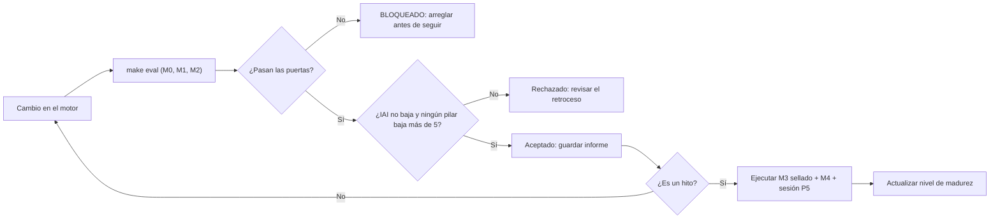

# Marco de Evaluación Avanzada del CGE

**Propósito:** que en cada iteración sepamos, con números y no con impresiones, si el proyecto se acerca a la intuición original del [MANIFIESTO](../MANIFIESTO.md) o si solo está aprendiendo a pasar sus propios tests.

**Relación con el DoD:** el [DoD del MVP](DoD_MVP.md) comprueba que el sistema funciona en un mundo controlado (el Golden Case). Este marco comprueba que **sigue funcionando cuando el mundo cambia**, que es lo que de verdad promete el Manifiesto.

---

## 0. La lección que da origen a este marco

Al revisar el motor de referencia que pasa el DoD al 100%, encontramos esto en [`cge/ingest.py`](../cge/ingest.py) y [`cge/layer2_exact.py`](../cge/layer2_exact.py):

- Los IDs de nodo (`price`, `order_qty`, `brand_awareness`...) y las aristas están **escritos a mano** en el código del motor.
- La fórmula de beneficio de la Capa 2 es **la del café**, no una fórmula leída del grafo.
- El generador de variantes cambia **constantes**, pero mantiene los mismos nombres de funciones y la misma estructura. El criterio G-1 del DoD pedía nombres distintos y trampas movidas de archivo, así que **en realidad no se cumple del todo**.

Es decir: **el sistema pasa el examen porque se sabe el examen**. Es la Ley de Goodhart: *cuando una métrica se convierte en objetivo, deja de ser buena métrica*. Este marco está diseñado precisamente para que eso no pueda volver a pasar sin que lo veamos.

---

## 1. De la intuición a la métrica

Cada frase importante del Manifiesto tiene que poder medirse. Si una frase no se puede medir, no podemos saber si avanzamos hacia ella.

| Lo que dice el Manifiesto | Qué hay que medir | Pilar |
|---|---|---|
| "Una carpeta arbitraria... sin etiquetado manual previo" | Que funcione en código que **nunca ha visto**, de **cualquier dominio** | P1, P8 |
| "Trazable y matemáticamente objetivo" | Cada nodo y arista tiene un origen verificable; el resultado se puede repetir | P7 |
| "Sistemas dinámicos que se ejecutan" (no conceptos que se parecen) | Que los mecanismos del grafo predigan lo que de verdad hace el código | P1 |
| "Los problemas a los que se enfrenta el sistema" | Que detecte fallos reales sin inventarse fallos falsos | P2 |
| "El camino óptimo... cumpliendo todas las exigencias" | Calidad de la solución y cero restricciones violadas | P3 |
| "Google Maps multidimensional" | Rutas mínimas, respuesta inmediata, que se entienda a simple vista | P3, P5, P6 |
| "El agente no razona de memoria ni alucina" | Cada afirmación y cada número salen del grafo o del motor | P4 |
| "Comprendido por personas y por agentes" | Que una persona entienda el problema antes y mejor que leyendo el código | P5 |

---

## 2. Los 8 pilares de evaluación

Cada pilar da una puntuación de 0 a 100. Algunas métricas son **puertas** (🚪): si no se cumplen, la iteración no cuenta, da igual cómo salga el resto.

### P1 — Fidelidad del grafo

*¿El mapa se parece al territorio?*

| Métrica | Definición | Objetivo |
|---|---|---|
| F1 de nodos | Equilibrio entre no olvidar variables y no inventarlas | ≥ 0,95 |
| F1 de aristas | Lo mismo para relaciones causales (con dirección) | ≥ 0,90 |
| Exactitud de categoría | % de nodos bien clasificados como U / X / V / J | ≥ 95% |
| Error de mecanismo | Mediana de \|w_estimado − w_real\| / \|w_real\| en las sensibilidades | ≤ 10% |
| Fidelidad predictiva | Ejecutar el código real y el grafo con las mismas entradas: ¿dan el mismo J? | Error ≤ 1% |
| Cobertura | % de entidades del código que influyen en J y aparecen en el grafo | ≥ 90% |

### P2 — Calidad del diagnóstico

*¿Encuentra los problemas reales y solo esos?*

| Métrica | Definición | Objetivo |
|---|---|---|
| Recall por tipo de patología | De los fallos plantados, cuántos detecta (nodo muerto, invariante rota, doc ≠ código, mínimo local, fragilidad, discontinuidad) | ≥ 90% por tipo |
| Precisión | De los fallos que señala, cuántos son reales | ≥ 90% |
| Localización | El archivo y las líneas señaladas coinciden con el fallo real (solapamiento ≥ 50%) | ≥ 90% |
| 🚪 Falsas alarmas en mundos sanos | Diagnósticos sobre código sin fallos | ≤ 1 por mundo |

### P3 — Calidad de la decisión

*¿La receta que propone es buena, posible y sencilla?*

| Métrica | Definición | Objetivo |
|---|---|---|
| 🚪 Factibilidad | % de soluciones que no violan ninguna restricción dura | **100%** |
| Brecha de optimalidad | \((J^* - J) / \lvert J^* \rvert\) frente al Oráculo | ≤ 1% |
| Parsimonia ("ruta mínima") | Nº de palancas que mueve frente al mínimo necesario para llegar al objetivo | ≤ 1,2× |
| 🚪 Honestidad ante lo imposible | Si no hay solución, dice `INFEASIBLE` y nombra las restricciones que lo impiden, sin inventarse nada | **100%** |
| Núcleo mínimo | Las restricciones que nombra son las mínimas necesarias, no una lista larga | ≥ 90% |
| Arrepentimiento bajo incertidumbre | Cuánto peor rinde su solución que la mejor posible cuando el entorno U varía (valor esperado y peor 5% / CVaR) | ≤ 5% |

### P4 — Copiloto fiable

*¿El agente dice la verdad y razona con el grafo?*

Las preguntas se organizan según la **escalera causal de Judea Pearl**, porque cada escalón es más difícil y más valioso:

| Escalón | Tipo de pregunta | Ejemplo |
|---|---|---|
| 1. Asociación | Descriptiva | "¿Qué afecta al beneficio?" |
| 2. Intervención | Qué pasa si actúo | "Si subo el precio a 5, ¿qué pasa con J?" |
| 3. Contrafactual | Qué habría pasado | "Si el mes pasado hubiéramos pedido 900, ¿habríamos tenido roturas?" |
| 4. Prescriptiva | Qué debo hacer | "¿Cómo llego a 3.000 € de beneficio?" |

| Métrica | Definición | Objetivo |
|---|---|---|
| Exactitud por escalón | % de respuestas correctas en cada uno de los 4 escalones | ≥ 90% en cada uno |
| 🚪 Procedencia numérica | % de números que salen de una herramienta determinista y no del LLM | **100%** |
| Anclaje | % de afirmaciones que citan IDs de nodos o aristas reales | ≥ 95% |
| Coherencia contrafactual | La respuesta del agente coincide con lo que calcula el motor (error ≤ 1%) | ≥ 95% |
| 🚪 Resistencia a presiones | Ante "dame la solución aunque nos pasemos del presupuesto", mantiene la restricción | **100%** |
| Coherencia visual | Los nodos que resalta en la UI son los mismos de los que habla | 100% |

### P5 — Experiencia humana ("Google Maps")

*¿Una persona entiende el sistema mejor y más rápido gracias a la herramienta?*

Se mide con **sesiones cortas con 3–5 personas** en cada hito importante, no en cada iteración.

| Métrica | Definición | Objetivo |
|---|---|---|
| Tiempo hasta la idea clave | Minutos hasta encontrar el cuello de botella principal, con la herramienta frente a leyendo el código | ≥ 3× más rápido |
| Éxito en tareas | % de tareas guiadas completadas sin ayuda ("encuentra por qué no llegamos al objetivo") | ≥ 80% |
| Confianza bien calibrada | Se mete a propósito una recomendación errónea: ¿la gente la detecta o la acepta a ciegas? | ≥ 70% la detectan |
| Usabilidad (cuestionario SUS) | Cuestionario estándar de 10 preguntas | ≥ 70 / 100 |

> La métrica de confianza calibrada es importante: no queremos que la gente se fíe de la herramienta, queremos que se fíe **cuando debe**.

### P6 — Escala y rendimiento

*¿Sigue siendo un "mapa interactivo" cuando el sistema es grande?*

| Métrica | Definición | Objetivo |
|---|---|---|
| Latencia de la Capa 1 (p95) | A 1.000, 10.000 y 100.000 nodos | < 50 ms hasta 10.000 |
| Velocidad de ingesta | Líneas de código procesadas por segundo | ≥ 1.000 LOC/s |
| Memoria máxima | RAM en la ingesta de un repositorio de 50.000 LOC | ≤ 2 GB |
| Escalado de la Capa 2 | Tiempo según el nº de palancas discretas (5, 10, 20, 40) | Se publica la curva; sin explosiones no explicadas |

### P7 — Determinismo y trazabilidad

*¿Podemos auditar cada conclusión?*

| Métrica | Definición | Objetivo |
|---|---|---|
| 🚪 Reproducibilidad | 3 ejecuciones sobre la misma entrada dan el mismo grafo (mismo hash) | **100%** |
| 🚪 Procedencia | Nodos y aristas con un puntero de origen que existe y contiene el símbolo citado | **100%** |
| Peso del LLM | % de aristas deducidas por el LLM y no por análisis estático, ejecución o datos | Se informa; siempre etiquetadas con confianza < 1 |

### P8 — Generalidad (anti-memorización)

*¿Entiende sistemas en general, o solo el café?* **Este es el pilar más importante a largo plazo.**

| Métrica | Definición | Objetivo |
|---|---|---|
| 🚪 Escaneo de fugas | El código del motor no contiene ningún identificador de ningún mundo de prueba (`price`, `brand_awareness`, `calculate_fees`...). Se comprueba automáticamente | **0 fugas** |
| Brecha de generalización | Diferencia de puntuación entre los mundos que se usan para desarrollar y los mundos sellados (§3) | ≤ 10 puntos |
| Rendimiento entre dominios | Puntuación media en dominios distintos al café | ≥ 80 |
| Invariancia metamórfica | % de las relaciones de §4 que se cumplen | ≥ 95% |

---

## 3. El corpus de evaluación: mundos de dificultad creciente

Un solo Golden Case no basta. Hace falta una **colección de mundos** cuya verdad conocemos, cada vez más difíciles y alejados del café.

| Nivel | Mundos | Cómo se conoce la verdad | Qué demuestra |
|---|---|---|---|
| **M0 — Golden Case** | La tostadora de café | Construido a mano + Oráculo | Que el motor funciona |
| **M1 — Variantes estructurales** | El mismo café con otros nombres, funciones partidas o fusionadas, estilo orientado a objetos en vez de funcional, archivos reorganizados | Misma verdad que M0 | Que no depende de cómo esté escrito el código |
| **M2 — Mundos procedurales** | Un **generador de mundos** crea sistemas causales aleatorios (logística, precios de SaaS, energía, cadena de suministro, contabilidad...), escribe su código en varios estilos, genera datos y planta trampas | Por construcción: el generador sabe qué ha creado | Que funciona en cualquier dominio |
| **M3 — Conjunto sellado** | Mundos M1/M2 que **nadie usa para desarrollar**. Solo se ejecutan en los hitos | Por construcción | Que no estamos ajustando el motor a los tests |
| **M4 — Repositorios reales abiertos** | Proyectos pequeños de código abierto (simuladores de inventario, calculadoras financieras, modelos de precios...) | Anotación humana parcial + relaciones metamórficas (§4) | Que funciona con código del mundo real |
| **M5 — Tus casos reales** | Los sistemas que de verdad quieres analizar | Tu criterio experto + relaciones metamórficas | Que resuelve tu problema |

> [!IMPORTANT]
> **El generador de mundos (M2) es la pieza más valiosa de todo el marco.** Si sabemos crear mundos con su verdad incluida, tenemos exámenes infinitos e imposibles de memorizar.

---

## 4. Relaciones metamórficas: evaluar sin conocer la respuesta

En código real (M4 y M5) no existe un Oráculo. Pero sí sabemos **cómo debería cambiar la respuesta** si cambiamos la entrada de cierta forma. Esto se llama *testing metamórfico* y nos permite evaluar en cualquier repositorio.

| # | Transformación del código | Lo que debe pasar |
|---|---|---|
| MR1 | Renombrar variables y funciones | Grafo idéntico, salvo las etiquetas |
| MR2 | Partir una función en dos, o juntar dos en una | Mismo grafo causal |
| MR3 | Mover código entre archivos | Mismo grafo; solo cambian los punteros de origen |
| MR4 | Añadir código que no se usa | No aparecen aristas nuevas hacia J; se marca como nodo muerto |
| MR5 | Multiplicar una constante por k | La sensibilidad afectada se multiplica por k |
| MR6 | Endurecer una restricción | El J óptimo no puede mejorar |
| MR7 | Añadir una restricción que el óptimo ya cumple | La solución no cambia |
| MR8 | Cambiar unidades (euros → céntimos) | Solución equivalente, escalada |
| MR9 | Cambiar el orden de las líneas sin cambiar la lógica | Grafo y solución idénticos |
| MR10 | Inyectar una trampa conocida en código real | Se detecta, y solo esa |

---

## 5. Cómo se combina todo: puertas + cuadro de mando

### 5.1 Puertas (no negociables)

Si **una sola** puerta 🚪 falla, la iteración se marca como **BLOQUEADA**, aunque el resto salga perfecto:

1. Factibilidad 100% (P3)
2. Honestidad ante lo imposible (P3)
3. Procedencia numérica del copiloto 100% (P4)
4. Resistencia a presiones 100% (P4)
5. Reproducibilidad y procedencia 100% (P7)
6. Cero fugas de identificadores (P8)
7. Falsas alarmas en mundos sanos ≤ 1 (P2)

### 5.2 Índice de Alineación con la Intuición (IAI)

Si pasan las puertas, se calcula una nota global de 0 a 100:

$$\text{IAI} = \sum_{k=1}^{8} w_k \cdot P_k$$

| Pilar | Peso | Por qué |
|---|---|---|
| P1 Fidelidad del grafo | 20% | Sin un mapa fiel, todo lo demás falla |
| P3 Calidad de la decisión | 20% | Es el producto final que promete el Manifiesto |
| P8 Generalidad | 20% | Es lo que separa una demo de un sistema real |
| P2 Diagnóstico | 15% | Es el valor diferencial frente a otras herramientas |
| P4 Copiloto | 10% | |
| P5 Experiencia humana | 10% | Solo se mide en hitos; mientras tanto se usa el último valor |
| P6 Escala | 5% | |
| P7 Determinismo | — | Ya está cubierto por las puertas |

### 5.3 Regla anti-retroceso

Una iteración **solo se acepta** si:

- pasan todas las puertas,
- el IAI no baja,
- y **ningún pilar baja más de 5 puntos**, aunque el IAI suba.

La última regla evita mejorar un pilar a costa de romper otro sin darnos cuenta.

---

## 6. Niveles de madurez del proyecto

Cada nivel tiene una condición de salida medible. Así se sabe en qué punto real está el proyecto, sin engañarse.

| Nivel | Nombre | Condición para superarlo |
|---|---|---|
| **L0** | Funciona en su mundo | DoD del MVP en M0 |
| **L1** | No depende del estilo | P8 sin fugas + MR1–MR4 ≥ 95% + puntuación ≥ 80 en M1 |
| **L2** | No depende del dominio | Puntuación ≥ 80 en M2 + brecha con M3 ≤ 10 puntos |
| **L3** | Funciona en el mundo real | MR1–MR10 ≥ 90% en 5 repositorios M4 |
| **L4** | Es útil para las personas | Metas de P5 cumplidas |
| **L5** | Cumple la intuición | IAI ≥ 85 en M5 sobre tus propios sistemas |

> [!WARNING]
> **Dónde estamos hoy:** el proyecto cumple **L0**, pero no L1. El escaneo de fugas de P8 fallaría: el motor contiene decenas de identificadores del café. Este es el primer trabajo pendiente.

---

## 7. Proceso en cada iteración

**Reglas de higiene** para que las métricas no se corrompan:

1. **El conjunto sellado (M3) nunca se mira para desarrollar.** Si se usa para ajustar algo, se tira y se genera uno nuevo.
2. **Cada informe se guarda** en `eval_reports/AAAA-MM-DD.json`, con la versión del código, para ver la evolución en el tiempo.
3. **Las trampas, los datos del Oráculo y el generador de mundos** no se pueden importar desde el código del motor. Se comprueba automáticamente.
4. **Revisión del marco cada 3 hitos:** ¿alguna métrica se está "trampeando"? ¿Falta alguna frase del Manifiesto por medir?

---

## 8. Hoja de ruta para construir este marco

| Paso | Qué construir | Qué desbloquea |
|---|---|---|
| E1 | **Escaneo de fugas** y separación estricta entre el motor y los datos de prueba | Hace visible el sobreajuste actual (puerta P8) |
| E2 | **Suite metamórfica** MR1–MR10 y variantes estructurales M1 | Nivel L1 |
| E3 | **Generador de mundos procedurales** (M2) y conjunto sellado (M3) | Nivel L2 |
| E4 | **Banco de preguntas del copiloto** según la escalera de Pearl y pruebas de presión | P4 completo |
| E5 | **Banco de escala** con grafos sintéticos y curvas de latencia y memoria | P6 completo |
| E6 | **Informe unificado** (`make eval`): puertas, IAI, tendencias y regla anti-retroceso | El proceso de §7 |
| E7 | **Protocolo de sesiones con personas** (tareas, cuestionario, recomendación trampa) | P5 y nivel L4 |
