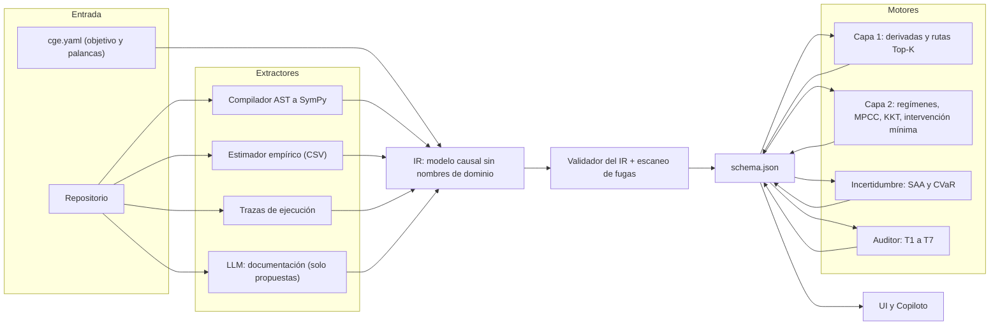

# Plan de construcción del motor CGE

**Base:** [MANIFIESTO](../MANIFIESTO.md) · [DoD del MVP](DoD_MVP.md) · [Marco de evaluación](MARCO_EVALUACION.md) · [Laboratorio matemático](../math_lab/README.md)

---

## 1. Revisión del trabajo matemático (`math_lab/`)

### 1.1 Veredicto

**Las matemáticas son sólidas y el diagnóstico es correcto.** El laboratorio encontró fallos reales del motor actual:

- La Capa 1 suma inversas cuando debería multiplicar sensibilidades a lo largo de la ruta.
- El optimizador se coloca justo encima del punto donde `min(demanda, stock)` cambia de rama y pierde ~138 € de media por la incertidumbre (desigualdad de Jensen).
- El auditor contable cuenta llamadas en vez de sumar importes.
- El estimador empírico usa el coeficiente verdadero para "estimar".

Y propone técnicas adecuadas para cada problema.

**Pero los prototipos todavía no son componentes reutilizables: son demostraciones sobre el café.** Lo comprobé en el código:

| Prototipo | Qué es general | Qué sigue atado al café |
|---|---|---|
| `exp01` · `ASTFunctionToSymPy` | **El compilador de código Python a ecuaciones simbólicas es general** | `SymbolicSCM` decide qué es palanca o entorno según el **nombre del archivo** (`config.py`, `environment.py`) y el prefijo `sample_` |
| `exp02` · `UniversalLayer2Solver` | La idea de partir en regímenes, el diagnóstico KKT y la intervención mínima | 86 referencias a `price`, `order_qty`, `marketing_budget`, `base_demand`... Su firma es `evaluate(price, marketing_budget, order_qty)` |
| `exp03` · Optimizador estocástico | El CVaR y la idea de partir la integral en el punto de cambio | La fórmula cerrada solo vale para *una* variable U normal y esta estructura concreta de demanda |
| `exp04` · Auditor simbólico | `SymbolicLedger` y la taxonomía T1-A/B/C son generales | Parte del auditor reutiliza `SymbolicSCM` y sus convenciones |
| `exp05` · MPCC, tiempo, IV | Las técnicas son generales | Son bancos de prueba sintéticos aparte, no están conectados al pipeline |

> [!NOTE]
> No es un defecto del agente matemático: su trabajo era demostrar *qué matemáticas funcionan*. Pero si su código se copia tal cual a `cge/`, el escaneo de fugas del marco de evaluación (P8) volverá a fallar.

### 1.2 Qué hacer con cada técnica

| Técnica | Etapa del Manifiesto | Decisión |
|---|---|---|
| Compilador AST → SymPy (`if` → `Piecewise`, `min`/`max`, sustitución de variables) | Ingesta | ✅ **Adoptar**: es el corazón de la ingesta |
| Derivadas en modo inverso sobre el grafo (O(V+E)) | Auditoría, Capa 1 | ✅ Adoptar |
| Elasticidades sin unidades + rutas de mayor producto (Top-K) | Capa 1 | ✅ Adoptar |
| Derivadas laterales / subdiferencial de Clarke y saltos | Auditoría T5, T6 | ✅ Adoptar |
| Ejecución simbólica de invariantes (`SymbolicLedger`) | Auditoría T2 | ✅ Adoptar, generalizado a cualquier invariante lineal |
| Nodos muertos T1-A / B / C | Auditoría T1 | ✅ Adoptar |
| Pérdida por óptimo local (dos optimizaciones: libre y fijada) | Auditoría T4 | ✅ Adoptar |
| Factibilidad elástica ℓ1 + precios sombra KKT | Capa 2, imposibles | ✅ Adoptar |
| Intervención mínima ℓ1 (recetas que tocan pocas palancas) | Capa 2, receta | ✅ Adoptar |
| Partición en regímenes + homotopía/MPCC para muchos `min`/`max` | Capa 2 | 🔁 **Reescribir** de forma genérica, leyendo el IR (§3) |
| Optimización del valor esperado y CVaR | Incertidumbre | 🔁 Reescribir con muestreo (SAA / cuasi-Monte Carlo) para varias U; la fórmula cerrada queda como **test** |
| Estimación conjunta + BIC + número de condición + confianza calculada | Datos empíricos | 🔁 Reescribir para cualquier nodo con datos |
| Grafo desplegado en el tiempo + control predictivo (MPC) | Sistemas con ciclos | ⏸️ **Posponer** a la fase 6 |
| Endogeneidad, variables instrumentales y back-door | Datos observacionales | ⏸️ Posponer |
| SMT con Z3, descubrimiento causal en logs | Lógica discreta, cajas negras | ⏸️ Posponer |

**Los resultados numéricos del laboratorio** (J* = 2990,88 €, brecha de Jensen = 138,54 €, E[J] estocástico = 2925 €, pérdida T4 = 680,88 €...) **se convierten en tests de regresión** del Golden Case. Así sus fórmulas cerradas sirven para validar el motor genérico.

---

## 2. Qué falta diseñar antes de construir

Tenemos **qué medir** (DoD + marco de evaluación) y **con qué matemáticas** (math_lab). Falta **cómo encaja todo**. Son 8 piezas de diseño; las marcadas con 🧑 necesitan una decisión tuya.

### D1 — La representación intermedia (IR): el contrato central

Es la pieza más importante que falta. Hoy cada módulo lee el código del café a su manera. Hace falta **un único modelo interno** del sistema causal $\mathcal{M} = \langle U, X, V, \mathcal{F}, \mathcal{C}, J \rangle$, con IDs opacos, mecanismos como expresiones simbólicas, regímenes, distribuciones, restricciones y procedencia.

**Regla de oro:** los extractores *escriben* el IR y todo lo demás *solo lee* el IR. **Ningún módulo posterior al IR puede conocer nombres del dominio.** Esto es lo que hace que el sistema funcione con cualquier tema.

Entregable: `docs/IR_SPEC.md` + el `canonical_schema.json` v1.1 (que ya propuso el laboratorio en su Propuesta 05).

### D2 — 🧑 ¿Quién decide qué es U, X, V y J?

Hoy se decide por nombre de archivo, y eso no sirve con código arbitrario. Opciones:

| Opción | Cómo funciona | Pros / contras |
|---|---|---|
| **A. Declaración del usuario** | Un pequeño archivo `cge.yaml` dice "el objetivo es `profit`, las palancas son estas tres". Todo lo demás lo deduce el sistema | Determinista y simple. Exige un paso manual mínimo |
| **B. Propuesta automática + confirmación** | El sistema propone la clasificación con su evidencia y el usuario confirma o corrige en la UI | Fiel al "sin etiquetado manual". Más complejo |
| **C. Totalmente automática** | El LLM y heurísticas deciden solos | Máxima ambición, pero la menos fiable y la más difícil de auditar |

**Recomendación:** empezar con **A** (en los mundos generados, la declaración viene con la verdad), diseñando el IR para que **B** se añada después sin cambiar nada más. El Manifiesto ya dice que el objetivo lo "define el usuario (o lo diagnostica el sistema)".

### D3 — 🧑 ¿Qué código entiende el motor y qué hace con el resto?

Hay que fijar el **subconjunto soportado** para el MVP:

- **Python puro:** funciones, aritmética, `if`/`else`, `min`/`max`, bucles con límites fijos y constantes de módulo.
- **Fuera del subconjunto:** clases con estado, I/O, llamadas a librerías. Esto se trata como **cajas negras**: nodos cuya función no se ve, pero cuya sensibilidad se mide *ejecutándolos* (diferencias finitas) o con datos. Quedan marcados con `confidence < 1`.

Así el sistema nunca falla en silencio: o entiende el código, o dice claramente qué no entiende.

### D4 — ¿De dónde salen las restricciones $\mathcal{C}$?

Nadie lo ha diseñado todavía. Fuentes posibles, por orden de fiabilidad:

1. `assert` y validaciones en el código
2. Cotas en la configuración
3. Declaración en `cge.yaml`
4. Tests
5. Documentación (vía LLM, marcada como "propuesta")

Hay que definir qué es una restricción **dura** y qué es **blanda** en cada caso.

### D5 — Política cuando las fuentes no coinciden

¿Qué pasa si el código dice 3%, el README dice 2% y los datos dicen 2,9%? Hace falta una **jerarquía de evidencia** explícita (por ejemplo: ejecución > código > datos > documentación > LLM). Y una regla clara: cuando no coinciden, **no se elige en silencio, se genera un diagnóstico** (así es como T3 deja de ser un caso especial).

### D6 — Selector de técnicas

El laboratorio ofrece varias técnicas para un mismo problema. Hace falta una regla que elija según las propiedades del grafo:

| Propiedad del IR | Técnica |
|---|---|
| Sin `min`/`max`/`if` (suave) | SLSQP directo |
| Pocos puntos de cambio (≤ ~8) | Enumerar regímenes (exacto) |
| Muchos puntos de cambio | Homotopía + MPCC |
| Hay U con distribución | Optimización estocástica (SAA) + CVaR opcional |
| Hay ciclos | Desplegar en el tiempo (fase 6) |

### D7 — Banco de pruebas que no se pueda memorizar (antes del motor)

Del marco de evaluación: escaneo de fugas, variantes estructurales (M1) y **generador de mundos** (M2). **Esto va antes que el motor**: si construimos el motor solo contra el café, volverá a aprenderse el café. El generador también necesita un **Oráculo genérico** (fuerza bruta sobre cualquier mundo generado), no solo el del café.

### D8 — 🧑 Cómo trabajan los agentes juntos

Para que nadie "apruebe su propio examen":

| Rol | Puede tocar | No puede tocar |
|---|---|---|
| **Coordinador** (tú + yo) | `docs/`, decisiones, prioridades | — |
| **Matemático** | `math_lab/` | `cge/`, `benchmark/` |
| **Constructor** | `cge/`, `ui/` | `benchmark/`, `oracle/`, `generator/` |
| **Evaluador** | `benchmark/`, `oracle/`, `generator/` | `cge/` |

Lo más importante: **el agente que construye el motor nunca modifica los tests ni el Oráculo.**

---

## 3. Arquitectura objetivo

---

## 4. Hoja de ruta por fases

Cada fase termina con una condición **medible** del [marco de evaluación](MARCO_EVALUACION.md).

| Fase | Qué se construye | Condición de salida |
|---|---|---|
| **F0 — Diseño** | D1–D6 escritos: `IR_SPEC.md`, `cge.yaml`, subconjunto soportado, jerarquía de evidencia, selector | Documentos aprobados por ti |
| **F1 — Banco imposible de memorizar** | Escaneo de fugas, variantes M1, generador de mundos v0 (3 dominios), Oráculo genérico, `make eval` con puertas e IAI | El motor actual se mide y **falla P8**: es la línea base honesta |
| **F2 — Ingesta → IR** | Compilador AST (de `exp01`) → IR, clasificación por `cge.yaml`, cajas negras, procedencia | P1 ≥ 0,95 en M0 + M1 · 0 fugas · reproducible |
| **F3 — Motor matemático genérico** | Derivadas inversas, rutas de mayor producto, solver por regímenes/MPCC, KKT + ℓ1, intervención mínima, todo leyendo solo el IR | Puertas de P3 en M0, M1 y M2 · brecha ≤ 1% |
| **F4 — Auditor genérico** | T1-A/B/C, invariantes simbólicas, Clarke/saltos, pérdida por óptimo local, conflictos de evidencia (D5) | P2 ≥ 90% en M0–M2 · ≤ 1 falsa alarma en mundos sanos → **nivel L1** |
| **F5 — Incertidumbre y datos** | SAA + CVaR, estimación empírica con confianza calculada | P3 bajo incertidumbre · brecha M2 vs M3 sellado ≤ 10 → **nivel L2** |
| **F6 — Copiloto y UI** | Copiloto con herramientas sobre el IR, preguntas por escalones de Pearl, UI reactiva | Puertas de P4 · primera sesión con personas (P5) |
| **F7 — Mundo real y extensiones** | Repositorios abiertos (M4), relaciones metamórficas, tiempo/MPC, IV, Z3 | MR1–MR10 ≥ 90% en 5 repositorios → **nivel L3** |

> [!IMPORTANT]
> **El orden importa:** F1 (el banco) va antes que F2–F5 (el motor). Es la diferencia entre construir algo que *entiende* y algo que *se sabe las respuestas*.

---

## 5. Protocolo de cada iteración

1. **Hipótesis:** qué métrica debe mejorar y por qué. Ejemplo: "pasar a rutas de mayor producto subirá R-1 en M2 del 60% al 95%".
2. **Diseño:** si hace falta matemática nueva, la diseña el Matemático en `math_lab/`, con un test.
3. **Construcción:** el Constructor implementa en `cge/`, sin tocar tests.
4. **Medición:** `make eval` → puertas + IAI + comparación con la iteración anterior.
5. **Decisión:** se acepta o se rechaza según la regla anti-retroceso del marco.
6. **Registro:** una nota breve en `docs/decisiones/NNN-titulo.md` con qué se probó, qué salió y qué se decidió.

El registro del punto 6 es lo que te da la trazabilidad que pides: en cualquier momento se puede ver por qué el motor es como es y qué métrica justificó cada cambio.
